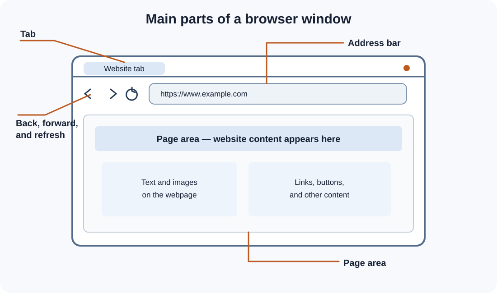
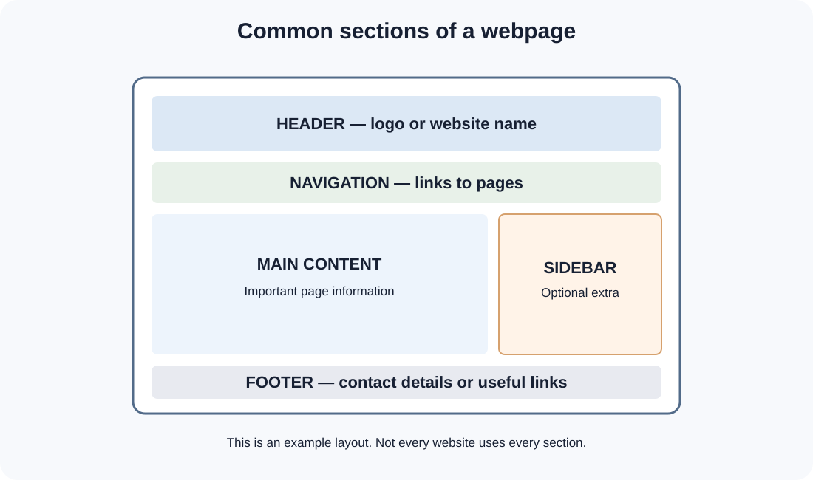

# Day 1 Practical Exercises — Explore the Web

**Student name:** ____________________  
**Date:** ____________________

## Practical rules

- Work carefully and follow the instructor's steps.
- Use only websites approved by your instructor.
- Do not enter personal information into unfamiliar websites.
- Ask for help if a page does not open.
- Write short answers in your own words.

\n\nUse this labelled illustration to help identify the browser controls. Your browser may look slightly different.\n\n## Activity 1 — Explore your browser (12 minutes)

Open your browser and find each item.

| Browser part | Found it? |
|---|---|
| Tab | Yes / Not yet |
| Address bar | Yes / Not yet |
| Back button | Yes / Not yet |
| Forward button | Yes / Not yet |
| Refresh button | Yes / Not yet |
| Page area | Yes / Not yet |

Now practise:

1. Open a new tab.
2. Enter a website address provided by your instructor.
3. Press Enter.
4. Use Back.
5. Use Forward.
6. Refresh the page.

**Question:** Which part of the browser shows the website address?

Your answer: __________________________________________

## Activity 2 — Read a URL (10 minutes)

Look at this example:

`https://www.example.com/about`

Complete the table.

| Part | Your answer |
|---|---|
| Scheme | |
| Domain name | |
| Path | |

Now look at the address bar on a website opened by your instructor. Write its domain name:

Domain: ______________________________________________

\n\nUse this wireframe as a guide. Look for the same sections on a real website.\n\n## Activity 3 — Find webpage sections (15 minutes)

Open a website selected by your instructor. Look for the following sections.

| Section | What did you find? |
|---|---|
| Header | |
| Navigation | |
| Main content | |
| Sidebar (if present) | |
| Footer | |

Some websites do not have a visible sidebar. Write "Not present" if you cannot find one.

## Activity 4 — Compare two websites (20 minutes)

Your instructor will select two websites. Observe them and complete the table.

| Question | Website A | Website B |
|---|---|---|
| What is the website about? | | |
| What can you see in the header? | | |
| Is there a navigation menu? | | |
| What is the main content? | | |
| Can you find a footer? | | |
| Which part is easiest to understand? | | |

Write two differences between the websites:

1. ____________________________________________________
2. ____________________________________________________

## Activity 5 — Explain the page request (5 minutes)

Put these steps in the correct order by writing numbers 1 to 5.

- [ ] The browser displays the webpage.
- [ ] The web server receives the request.
- [ ] You enter a URL in the browser.
- [ ] The server sends website content back.
- [ ] The browser sends a request over the internet.

## Final practical check

Explain these words to your partner:

- Internet
- Website
- Webpage
- Browser
- Web server
- URL

You do not need perfect wording. Explain each idea in simple English.

## What you should complete today

- [ ] I found the main browser controls.
- [ ] I read a basic URL.
- [ ] I identified webpage sections.
- [ ] I compared two websites.
- [ ] I explained how a browser gets a webpage.
