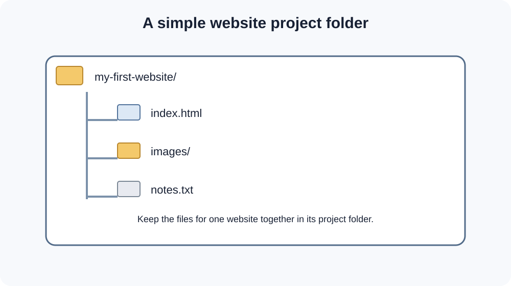
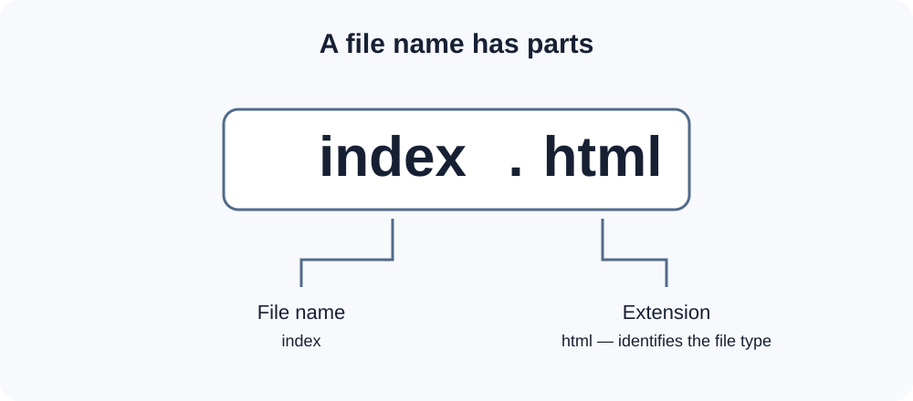

# Day 2 Lecture Notes — Files, Folders, and VS Code

## 1. What is a file?

A **file** stores information on a computer. A file can contain text, a picture, a video, or program code.

Examples:

- `index.html` — an HTML webpage file
- `style.css` — a CSS stylesheet
- `script.js` — a JavaScript file
- `notes.txt` — a plain text file
- `photo.jpg` — an image file

## 2. What is a folder?

A **folder** is a place used to organise files and other folders. A website project usually has one main folder containing all its files.



*Diagram 1: A small website project with a webpage file and an images folder.*

Keeping project files together makes them easier to find and manage.

## 3. What is a file extension?

A **file extension** is the part at the end of a file name, usually after a dot. It helps identify the file type.



*Diagram 2: In index.html, index is the file name and html is the extension.*

Common extensions in this course:

| Extension | Used for |
|---|---|
| `.html` | Webpage structure |
| `.css` | Webpage design and layout |
| `.js` | Webpage behaviour and interaction |
| `.txt` | Plain text |
| `.jpg`, `.png`, `.svg` | Images |

**Important:** Do not accidentally name your file `index.html.txt`. Make sure the file really ends in `.html`.

## 4. Good file and folder names

Use names that are clear and easy to read.

Good examples:

- `my-first-website`
- `index.html`
- `about.html`
- `images`
- `profile-photo.jpg`

Avoid confusing names with unnecessary spaces or symbols. Use lowercase letters and hyphens for project folders and many file names.

## 5. What is Visual Studio Code?

**Visual Studio Code (VS Code)** is a code editor. Developers use it to write and organise code.

Common parts of VS Code:

- **Activity Bar:** icons for tools such as Explorer and Search.
- **Explorer:** shows the files and folders in your project.
- **Editor:** the main area where you write code.
- **Tabs:** show files currently open in the editor.
- **Status Bar:** shows information about the current file and editor.

The instructor will show the actual VS Code window in class. The exact appearance can change between versions.

## 6. Create your first project folder

Follow these steps:

1. Open your computer's file manager.
2. Go to a location where you can easily find your work, such as Documents.
3. Create a new folder.
4. Name it `my-first-website`.
5. Open VS Code.
6. Choose **File → Open Folder**.
7. Select `my-first-website`.
8. If VS Code asks whether you trust the folder, follow the instructor's guidance. Only trust folders from sources you understand.

## 7. Create an HTML file

Inside VS Code:

1. Find the Explorer panel.
2. Select the New File icon.
3. Type `index.html`.
4. Press Enter.
5. Save the file if needed.

Your folder should now look like this:

```text
my-first-website/
└── index.html
```

We will write the HTML document in the next lesson.

## Key words

| Word | Simple meaning |
|---|---|
| File | A saved item containing information |
| Folder | A place for organising files |
| File extension | The ending that helps identify a file type |
| Code editor | An application used to write and edit code |
| Project folder | The main folder containing a project |
| Explorer | The VS Code panel that shows project files |

## Quick self-check

1. What is the difference between a file and a folder?
2. What does the `.html` extension identify?
3. What is VS Code used for?
4. What should the project folder be named today?
5. Which VS Code panel shows your files?

## Remember

Create one main folder for each project. Save related files inside it and use clear names. A well-organised project is easier to work on.
