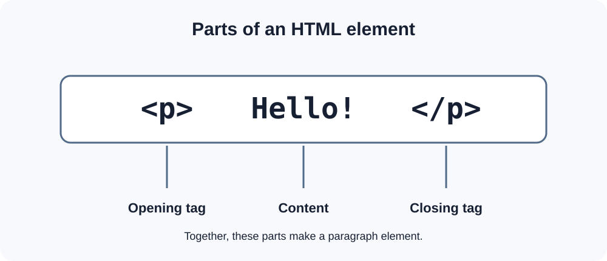
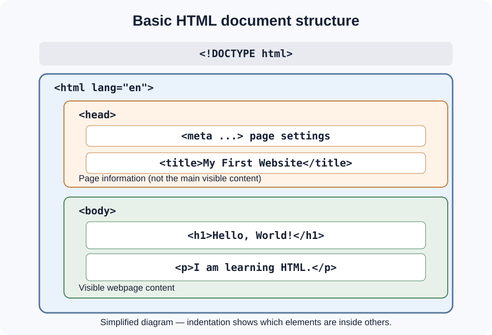

# Day 3 Lecture Notes — Your First HTML Page

## 1. What is HTML?

**HTML** means **HyperText Markup Language**. It gives webpage content its structure.

HTML tells the browser which parts of a page are headings, paragraphs, links, images, lists, and other content.

Remember:

- HTML gives content its structure.
- CSS controls how content looks.
- JavaScript adds behaviour and interaction.

Today we begin with HTML only.

## 2. What is an HTML tag?

An HTML **tag** is written inside angle brackets. For example:

`<p>`

Many HTML elements use an opening tag and a closing tag:

```html
<p>I am learning HTML.</p>
```

- `<p>` is the opening tag.
- `</p>` is the closing tag.
- The words between them are the content.
- The complete part is a paragraph element.



*Diagram 1: An opening tag, content, and closing tag make an element.*

Some HTML elements, such as `img`, do not wrap text and do not use a separate closing tag. We will learn about them later.

## 3. The basic HTML document

A webpage usually starts with a document structure. Study this example:

```html
<!DOCTYPE html>
<html lang="en">
<head>
  <meta charset="UTF-8">
  <meta name="viewport" content="width=device-width, initial-scale=1.0">
  <title>My First Website</title>
</head>
<body>
  <h1>Hello, World!</h1>
  <p>I am learning web development.</p>
</body>
</html>
```



*Diagram 2: The main parts of a simple HTML document.*

## 4. Understand the important lines

| Code | Simple purpose |
|---|---|
| `<!DOCTYPE html>` | Tells the browser to use modern HTML rules |
| `<html lang="en">` | Starts the HTML document and identifies its language |
| `<head>` | Holds information about the page |
| `<meta charset="UTF-8">` | Supports many characters and symbols |
| `<meta name="viewport" ...>` | Helps the page fit different screen sizes |
| `<title>` | Sets the title shown in the browser tab |
| `<body>` | Holds the content displayed on the page |
| `<h1>` | Creates a main heading |
| `<p>` | Creates a paragraph |

Do not try to memorise every detail at once. Learn what each line does by using it.

## 5. Head and body

The `head` and `body` have different jobs:

- The **head** contains information about the webpage, such as its title and character settings.
- The **body** contains the content visitors see on the page.

The page title in `<title>` is not the same as the visible heading `<h1>`.

## 6. Create your first page

Open the `index.html` file created on Day 2. Type the example document into it.

Important tips:

1. Type each opening and closing tag carefully.
2. Keep the indentation neat.
3. Save your file.
4. Do not remove the document structure.
5. Change the title, heading, and paragraph to your own words.

## 7. Common beginner mistakes

| Mistake | Better approach |
|---|---|
| Forgetting a closing tag | Check that paired elements have opening and closing tags |
| Writing visible page content inside `head` | Put visible content inside `body` |
| Forgetting to save | Save before checking the browser |
| Misspelling a tag | Compare it with the example |
| Using several main headings without a reason | Start with one clear main heading |

## Key words

| Word | Simple meaning |
|---|---|
| HTML | Language used to structure webpage content |
| Tag | Markup written inside angle brackets |
| Element | A complete HTML part, often including tags and content |
| Attribute | Extra information written in an opening tag |
| Head | Document information area |
| Body | Visible webpage content area |
| Title | Text shown in the browser tab |

## Quick self-check

1. What does HTML do?
2. Which tag starts the visible page content?
3. Where do we write the page title?
4. What is the difference between a tag and an element?
5. Which tag creates a paragraph?

## Remember

HTML is about structure. Write a small amount of correct code, save it, and practise explaining what each part does.
