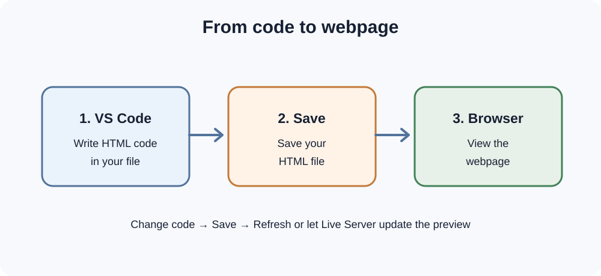
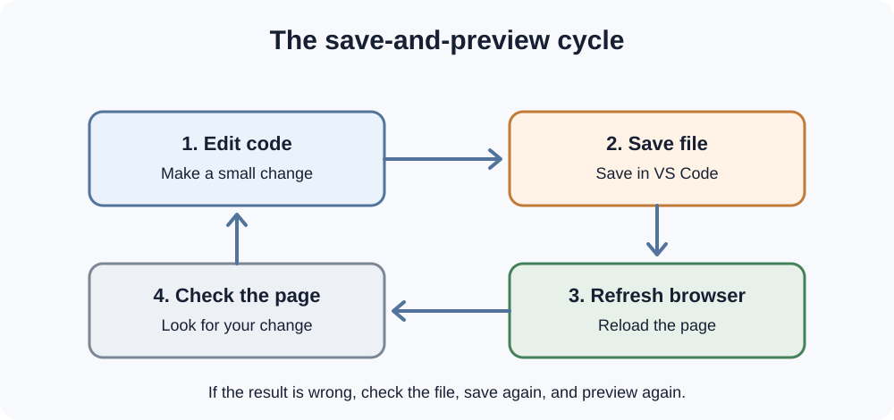

# Day 4 Lecture Notes — Preview Your Webpage

## 1. Why do we preview a webpage?

We write HTML in a code editor, but visitors view the result in a web browser.

A **preview** lets us check how the browser displays our HTML page. It helps us find mistakes and see our changes.

## 2. Editor and browser work together

- **VS Code:** where you write and save HTML code.
- **Browser:** where you view the webpage.

*Diagram 1: Write code in the editor, save it, and view the page in a browser.*

## 3. Open an HTML file in a browser

A simple way to preview a page:

1. Save `index.html` in VS Code.
2. Open your project folder in the computer's file manager.
3. Find `index.html`.
4. Double-click it, or right-click and choose a browser.
5. The page opens in your browser.

The browser may show a file address that begins with `file://`. That is normal when opening a local file directly.

## 4. Make a change and refresh

Try this process:

1. Change the heading in VS Code.
2. Save the file.
3. Return to the browser.
4. Refresh the page.
5. Check that the new heading appears.

*Diagram 2: Save your change before refreshing the browser.*

If the page does not change, check that you saved the correct file and refreshed the correct browser tab.

## 5. What is Live Server?

**Live Server** is a VS Code extension that can start a small local web server and open your webpage in a browser.

When you save changes, the browser can refresh automatically.

Live Server is useful during development, but it is not the same as publishing a website on the internet.

## 6. Use Live Server

If your instructor has installed and enabled Live Server:

1. Open your website project folder in VS Code.
2. Open `index.html`.
3. Find the **Go Live** control, often shown in the VS Code status bar.
4. Select it.
5. Your browser should open a local address.
6. Change a heading in VS Code and save.
7. Check the browser for the updated page.

The exact button or extension interface may change. Follow the version demonstrated by your instructor.

If Live Server is not installed or available, use the direct file-opening method. You can still complete today's learning outcomes.

## 7. Local preview and published website

- A **local preview** is viewed from files or a local development server on your computer.
- A **published website** is hosted so other people can access it through the internet.

We will learn to publish a static website later in the course.

## 8. Simple troubleshooting

| Problem | What to check |
|---|---|
| Browser shows an old heading | Save the file, then refresh |
| Browser shows the wrong page | Check the browser tab and file path |
| Page does not open | Check that the file exists and is named `index.html` |
| Go Live is not visible | Check whether Live Server is installed and enabled |
| Browser shows code as text | Check that the file ends in `.html` |
| Changes do not appear | Make sure you edited the same file the browser is showing |

## Key words

| Word | Simple meaning |
|---|---|
| Preview | A view of how a webpage appears |
| Refresh | Ask the browser to load the current page again |
| Extension | An add-on that gives an application extra features |
| Local | On your own computer |
| Local server | A server running on your computer |
| Live Server | A VS Code extension for local webpage preview |

## Quick self-check

1. Where do we write HTML code?
2. Which application displays the webpage?
3. Why do we save before refreshing?
4. What does Live Server help us do?
5. Does a local preview mean the website is published on the internet?

## Remember

If your changes do not appear, check the file, save it, and refresh the correct browser tab. Work carefully and check one thing at a time.
