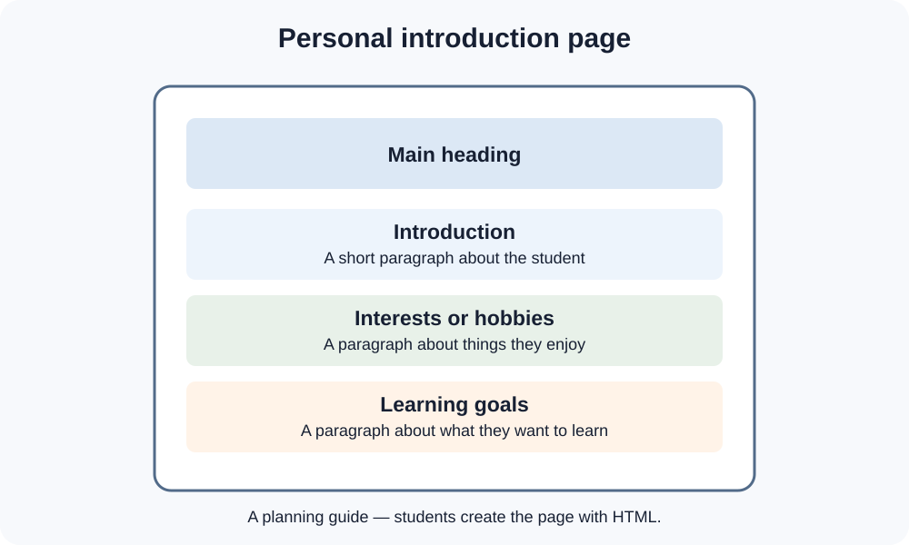

# Day 5 Lecture Notes — Review and Personal Webpage

## 1. What have we learned this week?

This week we learned the first steps of web development:

- The internet connects devices around the world.
- The web is a service that uses the internet.
- A website contains related webpages.
- A browser opens and displays webpages.
- A URL is a web address.
- A project folder keeps website files organised.
- VS Code is used to write and edit code.
- HTML gives webpage content its structure.
- A browser lets us preview our HTML page.

## 2. Review the basic HTML structure

A simple HTML page uses this structure:

```html
<!DOCTYPE html>
<html lang="en">
<head>
  <meta charset="UTF-8">
  <meta name="viewport" content="width=device-width, initial-scale=1.0">
  <title>My Personal Page</title>
</head>
<body>
  <h1>Welcome to My Page</h1>
  <p>This is my introduction.</p>
</body>
</html>
```

Remember:

- The title is written inside the head.
- The visible page content is written inside the body.
- The h1 element is the main heading.
- The p element creates a paragraph.

## 3. Plan your personal webpage

Before coding, decide what your page will say.



*Diagram 1: A simple layout for the personal introduction page.*

Use this plan:

| Page part | What to write |
|---|---|
| Page title | A short name for your page |
| Main heading | A welcome message or introduction |
| First paragraph | A short introduction |
| Second paragraph | Interests or hobbies |
| Third paragraph | What you want to learn |

You may use a fictional name. Do not publish private information such as your home address, personal phone number, passwords, or private account details.

## 4. Build the page step by step

1. Open your `my-first-website` folder in VS Code.
2. Open `index.html`.
3. Write the basic HTML structure.
4. Add your page title inside `<title>`.
5. Add one main heading inside `<body>`.
6. Add three paragraphs.
7. Save your file.
8. Open the page in a browser.
9. Check the content and correct mistakes.

## 5. Check your page

Ask yourself:

- Is the page title meaningful?
- Is there one clear main heading?
- Are all paragraphs inside the body?
- Did I save the file?
- Does the browser show the latest version?
- Is my writing safe to share?

## 6. Explain your work

Be ready to explain:

1. Which file contains your webpage?
2. Which application did you use to write HTML?
3. Which application did you use to view the page?
4. What does HTML do?
5. What did you find difficult?

## Week 1 key words

| Word | Simple meaning |
|---|---|
| Internet | A worldwide network connecting devices |
| Web | A service for viewing connected pages |
| Website | A group of related webpages |
| Browser | An application for viewing websites |
| URL | A web address |
| File | A saved item containing information |
| Folder | A place for organising files |
| HTML | Language used to structure webpage content |
| Element | A complete HTML part |
| Preview | A view of the webpage in a browser |

## Remember

A simple, complete webpage is a good first achievement. Focus on correct structure, clear content, saving your work, and checking the browser result.
