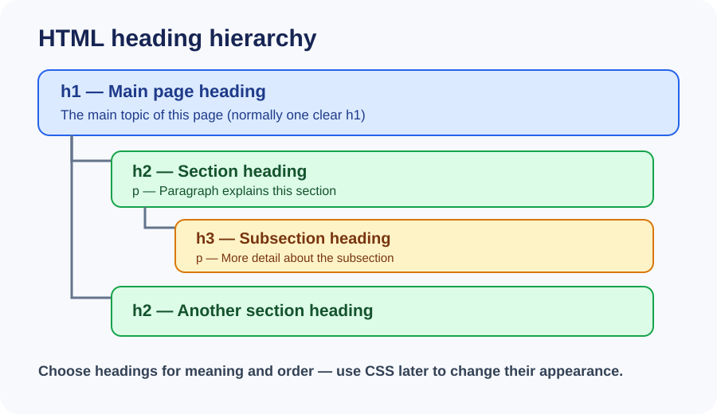

# Day 6 Instructor Guide — Headings and Paragraphs

## Lesson purpose

Students learn to organise page content with headings and paragraphs. Keep the focus on meaning and a clear content hierarchy, not on visual styling. CSS begins in Week 3.

## Before class

- Open `examples/index.html` in VS Code and check it in Chrome.
- Display the diagram `images/day-06-heading-hierarchy.svg`.
- Prepare a short topic students know, such as a school subject or favourite sport.
- Check that every learner can open the Week 1 project folder.
- Remind students to use safe, fictional profile details rather than private contact information.

## Learning outcomes

By the end, students should be able to:
1. Explain the difference between a page title and a visible heading.
2. Use one main `h1` and meaningful `h2` / `h3` subheadings.
3. Write paragraphs with `p` elements.
4. Preview the page and correct a simple tag error.

## 120-minute teaching plan

| Time | Activity |
|---|---|
| 0–20 min | Explain heading hierarchy, page title, and paragraphs. Use the diagram and ask students to describe the order. |
| 20–24 min | Quick review: ask what belongs in `head` and what appears in `body`. |
| 24–54 min | Build a short article live. Type in small steps, save, and preview after each section. |
| 54–116 min | Students complete guided practice, then the required About Me page. Support learners and check their heading order. |
| 116–120 min | Ask two learners to explain their structure; give homework and note who needs help. |

## Instructor demonstration

1. Open the starter example and point to `<title>` in the document head. Explain that it names the browser tab.
2. Point to `<h1>` in the body. Explain that it is the main visible page heading.
3. Add two `<h2>` sections under the main heading.
4. Add one or two `
` paragraphs under each section.
5. Show a deliberately poor structure with several `h1` elements used only because they look large. Ask what is wrong.
6. Correct the structure so heading levels describe the outline.
7. Save and refresh Chrome. Ask students to compare the code structure with the visible page.

## Visual teaching notes

Use `images/day-06-heading-hierarchy.svg` while explaining the order of headings. Trace the diagram from the page's main heading to its sections and subsections. Do not teach heading levels as font-size controls; explain that CSS will control appearance later.

## Questions to check understanding

- What is the difference between `<title>` and `<h1>`?
- Why should an `h2` describe a section under the main heading?
- Should we choose a heading because it looks big or because it describes the content?
- When should we use a paragraph?

## Common mistakes to watch for

- Skipping heading levels only to get a preferred visual size.
- Using headings for ordinary sentences that should be paragraphs.
- Putting visible page content inside `head`.
- Forgetting closing tags or nesting elements incorrectly.

## Support and extension

- **Extra support:** Give the learner a page outline with the heading text already written; ask them to add the correct tags.
- **Pair support:** One learner reads the outline aloud while the other checks the code. Both must edit and explain their own work.
- **Extension:** Add a third section with an `h3` subsection where it makes sense. Do not add CSS.

## Checkpoint

A learner is ready to finish when their page has one clear main heading, at least three meaningful section headings, paragraphs under the sections, and a browser preview that matches the intended outline. Ask the learner to explain why each heading level was chosen.
