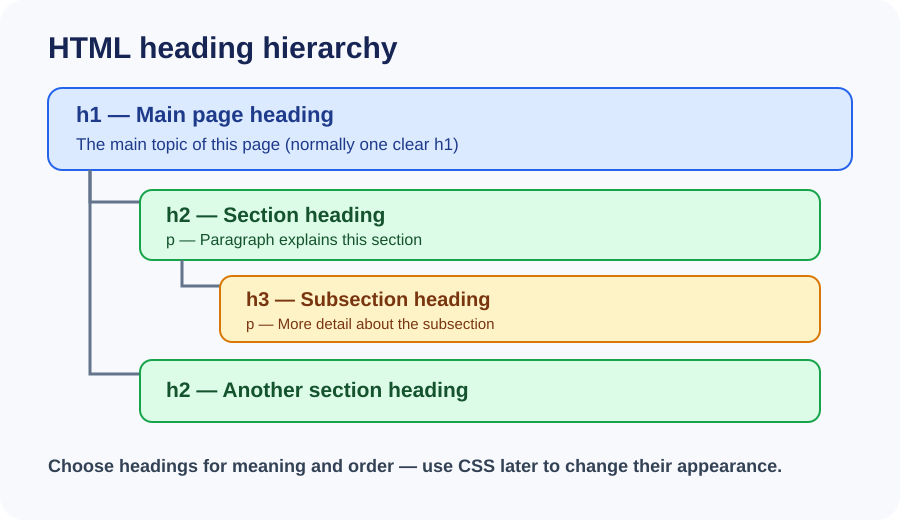

# Day 6 Practical Exercises — Headings and Paragraphs

## What you will practise

You will organise information using a main heading, section headings, and paragraphs. Work in your Week 2 project folder. Do not add CSS or JavaScript today.

## Exercise 1 — Read the page outline

Look at `images/day-06-heading-hierarchy.svg`.

1. Find the main page heading in the diagram.
2. Find the section headings below it.
3. Find the smaller subsection heading.
4. Explain why the paragraph text is not a heading.

## Exercise 2 — Guided practice

1. Open `examples/index.html` in VS Code.
2. Find the `title`, `h1`, `h2`, and `p` elements.
3. Change the example topic to a subject you know.
4. Add one new section with an `h2` and a paragraph.
5. Save the file and refresh Chrome.
6. Check that the browser tab title and visible page heading are different in the correct way.

## Exercise 3 — Required independent task: About Me page

Create or update an HTML page about yourself using safe information.

Your page must include:
- One `h1` for the main page heading.
- At least three `h2` section headings.
- At least one paragraph under each section.
- A useful `title` in the document head.
- Correct opening and closing tags.

Suggested sections: About Me, My Interests, and My Learning Goals. Do not include your home address, phone number, passwords, or other private information.

## Completion checklist

- [ ] I used one clear `h1`.
- [ ] My `h2` elements describe separate sections.
- [ ] I used paragraphs for normal sentences.
- [ ] My page title appears in the browser tab.
- [ ] I saved and checked the page in Chrome.
- [ ] I can explain why I chose each heading level.

## Optional challenge

Add one meaningful `h3` under an `h2` section. Use it only if the section really has a smaller subsection.

## Troubleshooting

- If text is missing, check whether it was typed inside the visible `body`.
- If the page outline looks confusing, compare the heading order with the diagram.
- If a tag changes the wrong content, check where its closing tag appears.
- If Chrome shows an old result, save the file and refresh.

## Expected result

A simple, readable HTML About Me page with a clear content outline. The structure should make sense even before CSS is added.
