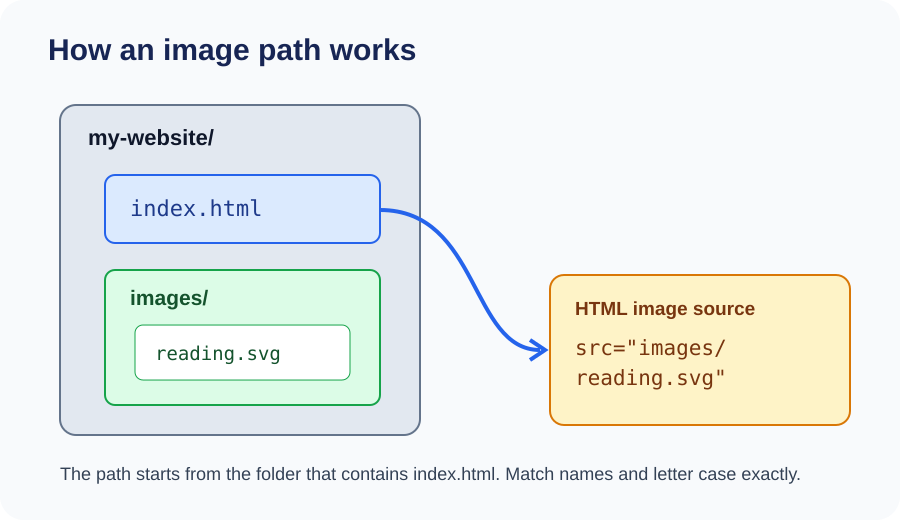

# Day 8 Instructor Guide — Images and Lists

## Lesson purpose

Students learn how to add an image responsibly and organise related information in ordered and unordered lists. Focus on correct file paths, useful alternative text, and choosing the right list type.

## Before class

- Open `examples/index.html` and confirm its local image file is present.
- Display `images/day-08-image-path.svg` and the existing `images/reading.svg` example asset.
- Check that image filenames and letter case match the code exactly.
- Prepare a numbered process and a collection of items to compare list types.
- Remind students to use images they have permission to use and avoid private photos.

## Learning outcomes

Students should be able to:
1. Add an image with `img`, `src`, and appropriate `alt` text.
2. Explain why the image path must match the folder structure.
3. Choose an unordered list for items without a required order.
4. Choose an ordered list for steps or rankings with a meaningful sequence.
5. Check a missing image and correct a path error.

## 120-minute teaching plan

| Time | Activity |
|---|---|
| 0–20 min | Explain image elements, paths, alt text, and list types using the diagrams. |
| 20–24 min | Review anchor links and relative paths from Day 7. |
| 24–54 min | Demonstrate adding a local image, writing useful alt text, and creating both list types. |
| 54–116 min | Students build a hobby page with an image, equipment list, and ordered steps. |
| 116–120 min | Check image loading and list choices; assign homework. |

## Instructor demonstration

1. Show the project folder in VS Code Explorer. Point out the HTML file and the image folder.
2. Explain that `src` is a path from the HTML file to the image file.
3. Add an image using the supplied local asset. Write alt text that describes the image's useful content.
4. Temporarily change one character in the path to demonstrate a broken image. Ask students what they notice.
5. Restore the correct path and refresh the browser.
6. Create an unordered list of hobby equipment.
7. Create an ordered list of steps for doing the hobby.
8. Ask why the order matters in one list but not the other.

## Visual teaching notes

Use `images/day-08-image-path.svg` to trace the relative path from the HTML file to the image. Use the browser preview to show the actual result. Explain that alt text is not a filename: it should communicate the image's relevant information. For a purely decorative image, an empty `alt=""` may be appropriate.

## Questions to check understanding

- What does the `src` attribute point to?
- Why can a file path work on one computer but fail if the folder is moved?
- What should useful alt text tell someone who cannot see the image?
- When is an ordered list better than an unordered list?

## Common mistakes to watch for

- Incorrect folder name, filename, extension, or letter case.
- Using a local path that points to the wrong folder.
- Leaving out the `alt` attribute.
- Writing alt text such as “image” or repeating a filename.
- Using an ordered list when the order has no meaning, or vice versa.

## Support and extension

- **Extra support:** Provide the exact image path and ask the learner to identify each folder part.
- **Pair support:** One learner checks the path in Explorer while the other checks the `src` value.
- **Extension:** Create a nested list for categories of interests or equipment.

## Checkpoint

Each learner should show an image that loads, useful alt text, one unordered list, and one ordered list. Ask them to explain why they chose each list type.
