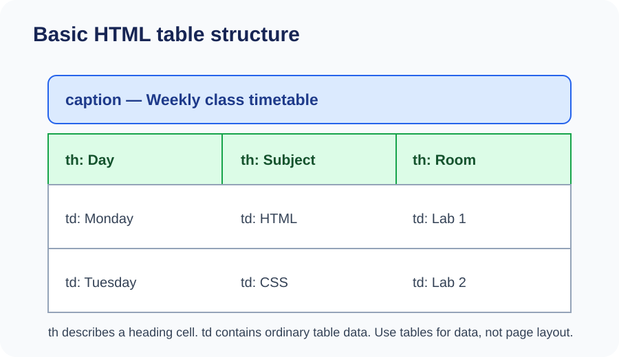
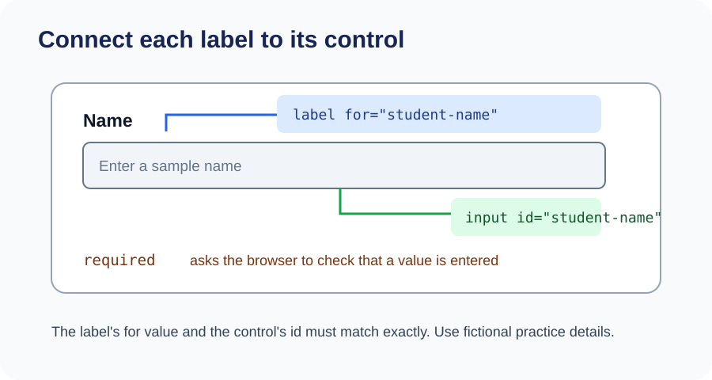

# Day 9 Instructor Guide — Tables and Forms

## Lesson purpose

Students learn to display structured information in a simple data table and collect sample input with an HTML form. Make the distinction clear: a table presents related data; a form provides controls for a user to enter information. HTML alone does not send or store form submissions.

## Before class

- Open `examples/index.html` and test it in Chrome.
- Display `images/day-09-table-structure.svg` and `images/day-09-form-labels.svg`.
- Prepare a small fictional weekly timetable.
- Check that the sample form uses fictional details only and does not request sensitive information.
- Be ready to explain that a browser's built-in validation is not a complete secure data system.

## Learning outcomes

Students should be able to:
1. Build a basic table using `table`, `tr`, `th`, and `td`.
2. Use header cells to explain the meaning of table columns or rows.
3. Create a form with labels and suitable input types.
4. Explain the purpose of `required` and browser validation.
5. Explain that a static HTML form does not store or send data by itself.

## 120-minute teaching plan

| Time | Activity |
|---|---|
| 0–20 min | Explain table structure and basic form controls using both diagrams. |
| 20–24 min | Review lists and the difference between ordered information and tabular data. |
| 24–54 min | Demonstrate a small timetable, then a labelled sample form. Test required fields in Chrome. |
| 54–116 min | Students build their own timetable and sample contact form with fictional details. |
| 116–120 min | Review table headings, form labels, and privacy. Remind students of the homework task. |

## Instructor demonstration

1. Start with a small timetable written as plain text. Ask why rows and columns help.
2. Build the table one row at a time using `table`, `tr`, `th`, and `td`.
3. Add a `caption` and, if appropriate, group header and body rows.
4. Explain that `th` identifies a heading cell and `td` holds ordinary data.
5. Build a form with a label and a text input. Connect the label's `for` value to the input's `id`.
6. Add an email input and a textarea. Demonstrate `required` and a submit button.
7. Try submitting with a required field empty. Explain the browser's basic validation message.
8. State clearly: no server or database is connected, so this classroom example does not send or save the data.

## Visual teaching notes

Use the table diagram to trace a row and distinguish heading cells from data cells. Use the form diagram to show that a label describes a control and is connected through matching `for` and `id` values. Keep the diagrams visible while students begin the task.

## Questions to check understanding

- When should information be displayed in a table instead of a list?
- What is the difference between `th` and `td`?
- Why should every form control have a clear label?
- What does `required` do in the browser?
- Does an HTML-only form send information to the academy? Why not?

## Common mistakes to watch for

- Missing table rows or putting cells outside a row.
- Using tables only to position page content.
- Using `td` for every cell, including column headings.
- A label's `for` value not matching the control's `id`.
- Missing input types or confusing `name` and `id`.
- Promising that a static form sends or stores a message.

## Support and extension

- **Extra support:** Give students a partly completed table and ask them to add one row at a time.
- **Pair support:** One learner reads each label aloud while the other checks the matching control.
- **Extension:** Add a checkbox or radio group for a non-sensitive sample question. Explain when only one choice should be selected.

## Privacy and safety

Use fictional names and example details. Never ask students to enter passwords, private addresses, identity numbers, or real personal contact information into the practice form. Do not publish collected information.

## Checkpoint

Students should show a correctly structured timetable and a form with connected labels, suitable input types, and at least one required field. They must be able to explain that the form is only a front-end example and does not store submissions.
