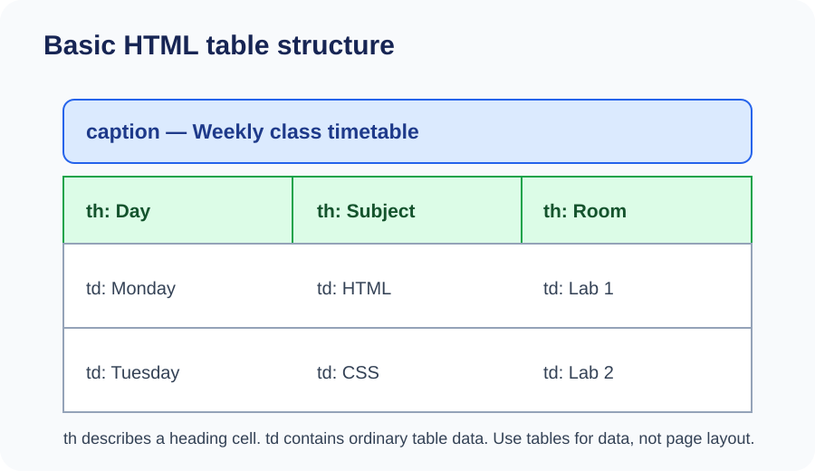
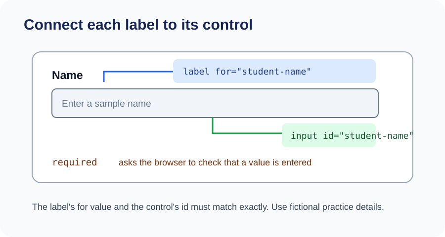

# Day 9 Lecture Notes — Tables and Forms





## Learning goal

Present simple information in a table and create a form with clearly connected labels and controls.

## Part A — HTML tables

## 1. When should we use a table?

A table displays information arranged in rows and columns. Tables are useful for data such as a timetable, marks list, or comparison of features.

Do not use a table just to arrange the visual layout of a webpage. We will learn layout with CSS.

## 2. The main table elements

- `<table>` contains the whole table.
- `<caption>` gives the table a short title.
- `<tr>` creates a table row.
- `<th>` creates a header cell.
- `<td>` creates a normal data cell.
- `<thead>` groups the header rows.
- `<tbody>` groups the main data rows.

Example:

```html
<table>
  <caption>Weekly Study Timetable</caption>
  <thead>
    <tr>
      <th scope="col">Day</th>
      <th scope="col">Topic</th>
      <th scope="col">Time</th>
    </tr>
  </thead>
  <tbody>
    <tr>
      <th scope="row">Monday</th>
      <td>HTML</td>
      <td>9:00 AM</td>
    </tr>
    <tr>
      <th scope="row">Tuesday</th>
      <td>Practice</td>
      <td>9:00 AM</td>
    </tr>
  </tbody>
</table>
```

## 3. Understand table rows and cells

Each tr creates one row. Inside the row, place the cells in order.

The first row in the example contains three header cells: Day, Topic, and Time. The next rows contain the information for each day.

The `scope` attribute explains whether a header describes a column or a row:

- `scope="col"` means the header describes a column.
- `scope="row"` means the header describes a row.

This helps assistive technology understand the relationship between table headings and data.

## 4. Check the number of cells

A simple table should normally have the same number of cells in each row. In the example, every row has three cells. If one row has only two cells by mistake, the information may appear under the wrong heading.

## Part B — HTML forms

## 5. What is a form?

A form provides controls that allow a visitor to enter information. Examples include a search box, registration form, or contact form.

The `<form>` element groups the controls. Inside it, we can use labels, inputs, text areas, and buttons.

Important: HTML can display a form and check some basic input rules in the browser, but HTML alone does not send the information to an email address or save it in a database. That needs a suitable service or server, which is outside this beginner course.

## 6. Labels and input fields

An input creates a field where a visitor can enter information.

```html
<label for="student-name">Name</label>
<input id="student-name" name="student-name" type="text">
```

The label's `for` value must match the input's `id` value. This connects the label to the correct field. Clicking the label can focus the input, and assistive technology can identify its purpose.

The `name` attribute identifies the field name when form data is handled by a server or service.

## 7. Common input types

The `type` attribute tells the browser what kind of input is expected.

| Type | Purpose |
|---|---|
| text | A short line of text |
| email | An email address |
| password | A password field that hides typed characters |
| number | A numeric value |
| date | A date |
| checkbox | A choice that can be checked or unchecked |
| radio | One choice from a related group |
| submit | A form submission control |

Use only the types needed for the task. Never ask students to enter real passwords or sensitive information in a classroom demo.

## 8. Make a field required

The `required` attribute tells the browser that a field must be completed before a normal form submission can proceed.

```html
<label for="email">Email</label>
<input id="email" name="email" type="email" required>
```

For an email input, the browser can check whether the value looks like an email address. This is a basic browser check, not a complete verification that the address exists.

## 9. Use textarea for a longer message

An input is usually used for a short value. A `<textarea>` gives the visitor a larger area for a longer message.

```html
<label for="message">Message</label>
<textarea id="message" name="message" rows="4"></textarea>
```

The rows attribute suggests the visible height of the text area.

## 10. Add a button

A button can be used to submit a form:

```html
<button type="submit">Send Message</button>
```

Inside a form, always choose the button type intentionally. The submit type requests form submission. A button with type="button" does not submit the form by default.

## 11. Complete example

This example is for classroom practice only. It has no server, so it does not send or store submitted information. Do not enter real private information.

```html
<!DOCTYPE html>
<html lang="en">
<head>
  <meta charset="UTF-8">
  <meta name="viewport" content="width=device-width, initial-scale=1.0">
  <title>Timetable and Sample Form</title>
</head>
<body>
  <h1>Weekly Study Timetable</h1>

  <table>
    <caption>Example class plan</caption>
    <thead>
      <tr>
        <th scope="col">Day</th>
        <th scope="col">Topic</th>
        <th scope="col">Time</th>
      </tr>
    </thead>
    <tbody>
      <tr>
        <th scope="row">Monday</th>
        <td>HTML</td>
        <td>9:00 AM</td>
      </tr>
      <tr>
        <th scope="row">Tuesday</th>
        <td>Practice</td>
        <td>9:00 AM</td>
      </tr>
      <tr>
        <th scope="row">Wednesday</th>
        <td>Review</td>
        <td>9:00 AM</td>
      </tr>
    </tbody>
  </table>

  <h2>Sample Contact Form</h2>
  <form>
    <p>
      <label for="name">Name</label><br>
      <input id="name" name="name" type="text" required>
    </p>
    <p>
      <label for="email">Email</label><br>
      <input id="email" name="email" type="email" required>
    </p>
    <p>
      <label for="message">Message</label><br>
      <textarea id="message" name="message" rows="4"></textarea>
    </p>
    <button type="submit">Submit sample form</button>
  </form>

  <p>This demonstration has no server. It does not send or store information.</p>
</body>
</html>
```

## 12. Common mistakes

| Mistake | How to fix it |
|---|---|
| Using td for every table cell | Use th for headings and td for normal data |
| Forgetting a tr | Put cells inside a table row |
| Label does not focus its field | Match label for with input id |
| Using the wrong input type | Choose a type that matches the expected information |
| Thinking required sends data | Required only checks the field in the browser |
| Expecting the demo form to email you | A backend or form service is needed for that |

## Key words

| Word | Simple meaning |
|---|---|
| Table | Information arranged in rows and columns |
| Row | A horizontal line of table cells |
| Header cell | A cell that describes a row or column |
| Data cell | A cell containing table information |
| Form | A group of controls for entering information |
| Label | Text that identifies a form control |
| Input | A field for entering a value |
| Textarea | A larger text-entry area |
| Required | A browser rule that a field must be completed |

## Quick self-check

1. What is the difference between th and td?
2. What does tr create?
3. How do label for and input id connect?
4. Which input type is suitable for an email address?
5. Does an HTML form alone send or save submitted information?

## Remember

Use tables for data, not page layout. Give every form field a connected label. Explain clearly that a front-end form does not send or save information without a service behind it.


## 13. Why table headings matter

A table is easier to understand when the first row identifies each column. A row heading can also identify what a particular row describes. The th element marks a heading cell, while td marks ordinary data.

In a timetable, Day, Topic, and Time describe the columns. Monday, Tuesday, and Wednesday identify each row. That is why the example uses scope="col" for column headings and scope="row" for row headings.

The caption gives the table a short name. Thead groups the heading rows, and tbody groups the main data. These elements make the code easier to understand and help tools interpret the table structure.

## 14. Table layout must match the data

Imagine a table with three column headings. Every normal row should provide data for those three columns. If one row has only two cells, the information may not line up with the correct headings. Count the cells in each row when checking your work.

Do not use a table to place a logo on the left and a menu on the right. That is page layout, not tabular data. CSS Flexbox and Grid will be taught later for layout.

## 15. How a form works in a browser

A form groups controls. A visitor types or selects information, then activates a submit button. The browser can check certain rules, such as whether a required field is empty or whether an email field looks like an email address.

For a real website, the form also needs a destination and a system that receives and handles the data. This can be a server or a form service. Our classroom example has no such destination. It is only for learning the HTML structure and browser validation.

Do not collect real student information in this practice form. Use fictional sample values.

## 16. More useful form attributes

| Attribute | Purpose |
|---|---|
| id | Identifies a control in the page and connects it to a label |
| name | Gives the field a name when data is processed |
| type | Selects the kind of input control |
| required | Makes the browser require a value before normal submission |
| placeholder | Shows a short hint inside an empty control |
| rows | Suggests the visible number of text lines in a textarea |

A placeholder is not a replacement for a label. The label should remain visible so the purpose of the field is clear even after someone types into it.

## 17. Checkboxes and radio buttons

A checkbox is suitable when a visitor can select more than one independent option. Radio buttons are suitable when a visitor should select one option from a group.

For example, a form might ask a learner to choose interests such as Design and Coding using checkboxes. A question about choosing one class shift, Morning or Afternoon, is better represented by radio buttons.

Radio buttons in one group share the same name. This tells the browser that they are alternatives in the same group. Each option still has its own value.

## 18. A safer and clearer form design

Keep forms simple. Put a clear label beside each control, use an appropriate input type, and ask only for information needed by the task. Avoid asking for passwords or sensitive information in a public practice project.

A form should also explain what happens after submission. In a real service, the visitor should know whether the information is sent, stored, or used. Our sample form does not send or save anything.

## 19. Real-world example: class timetable and enquiry form

A school website might use a table to show class days, topics, and times. A separate enquiry form might ask a visitor for a name, email address, and question. The table presents information for reading. The form collects information for a system to process. These are different jobs, so use the correct HTML elements for each.

## 20. Step-by-step form debugging

If a label does not focus the expected field, compare the label's for value with the input's id. They must match exactly. If browser validation does not appear, check that required is present and that the control is inside the form. If you expect a message to arrive by email, remember that an HTML-only form has no email service connected.

## 21. Extra common mistakes

- Using a table for page layout: tables are for related data in rows and columns.
- Using td for column headings: use th for header cells.
- Using placeholder instead of label: provide a real label for every control.
- Giving radio buttons different names: use the same name for one choice group.
- Assuming required checks whether information is true: it only performs browser-side checks.
- Assuming submit automatically stores information: a receiving service or server is needed.
