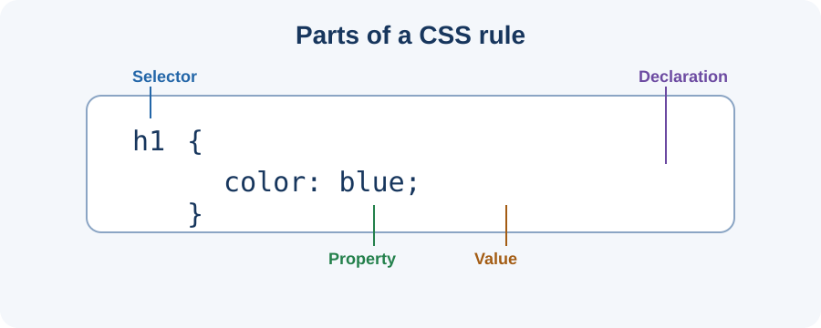

# Day 11 Instructor Guide — CSS Purpose and External Stylesheets

## Teaching purpose
Students already know how to create HTML. This lesson introduces CSS as the presentation layer and establishes the external stylesheet workflow used in later lessons.

**Duration:** 120 minutes. **Prerequisites:** Students can open a folder in VS Code, edit and save HTML, and preview it in Chrome.

## Prepare
- Test the supplied example in Chrome.
- Confirm that HTML and CSS file names and paths match.
- Prepare an unstyled HTML page for comparison.
- Display the CSS rule anatomy diagram.
- Ask students to open their Week 2 profile project.

## Learning outcomes
Students explain HTML versus CSS, identify selector/property/value, create an external stylesheet, link it correctly, and apply basic styles.

## 120-minute plan

| Minutes | Activity |
|---:|---|
| 0–20 | Explain HTML structure versus CSS presentation; compare styled and unstyled pages |
| 20–24 | Quick vocabulary review |
| 24–54 | Demonstrate a CSS rule, create `styles.css`, link it in `head`, and preview |
| 54–116 | Guided and independent student practice; troubleshoot individual projects |
| 116–120 | Students show their result and explain one CSS rule |

## Demonstration
1. Open an HTML page and show it in Chrome without CSS.
2. Create `styles.css` in the same folder.
3. Type a small `body` rule and explain each part.
4. Add `<link rel="stylesheet" href="styles.css">` inside `head`.
5. Save both files and refresh Chrome.
6. Change a colour and text size. Ask students to predict the result first.
7. Demonstrate a wrong path deliberately, then correct it.

## Questions
- Does HTML or CSS create the heading?
- What does a selector do?
- What is the property in `color: blue;`?
- Why is an external stylesheet useful?
- What could stop a CSS file from loading?

## Common mistakes and support

| Problem | Response |
|---|---|
| CSS typed in HTML body | Show separate CSS file and link in `head` |
| File named `styles.css.txt` | Show file extensions and rename carefully |
| Wrong `href` | Compare exact spelling in Explorer and HTML |
| Missing brace or colon | Return to the selector/declaration pattern |
| No visible change | Check path, syntax, save, then refresh |

## Differentiation
- Support: provide completed HTML and ask the student to create and link only the CSS file.
- Core: style the welcome page with background, text, and heading rules.
- Extension: link one stylesheet to a second HTML page.

## Checkpoint
Each student shows both files, a working stylesheet link, three visible style changes, and explains selector/property/value. Do not rush ahead if most students cannot identify a simple file-path error.

## Teaching visual

*Use this diagram while naming each part of the CSS rule.*
