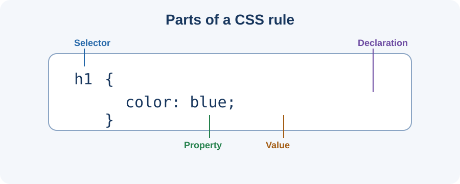

# Day 11 Lecture Notes — CSS Purpose and External Stylesheets

## 1. What is CSS?
CSS means **Cascading Style Sheets**. It describes how HTML content should look. HTML provides structure and meaning; CSS controls presentation such as colours, text, spacing, borders, and layout.

Think of a classroom: HTML is the room and furniture; CSS is the paint, decoration, and arrangement.

## 2. HTML and CSS have different jobs

HTML:

```html
<h1>Welcome to Our Academy</h1>
<p>Learn useful skills step by step.</p>
```

CSS:

```css
h1 {
  color: navy;
  font-size: 32px;
}
p {
  color: #444444;
}
```

The HTML creates the heading and paragraph. CSS changes how they look. Use meaningful HTML elements; do not use CSS as a replacement for good page structure.

## 3. Parts of a CSS rule

```css
h1 {
  color: navy;
  font-size: 32px;
}
```

- `h1` is the **selector**: it chooses the elements to style.
- `color` and `font-size` are **properties**: the features being changed.
- `navy` and `32px` are **values**: the settings.
- A property and value make a **declaration**.
- Curly braces `{ }` contain declarations.
- A semicolon `;` ends each declaration.

General pattern:

```css
selector {
  property: value;
}
```

## 4. Three ways to add CSS

### Inline CSS
Written inside an HTML element:

```html
<p style="color: red;">This text is red.</p>
```

It can be useful for a tiny demonstration, but it becomes difficult to manage on a full website.

### Internal CSS
Written inside a `style` element in the HTML `head`:

```html
<head>
  <style>
    p { color: green; }
  </style>
</head>
```

This keeps styles in one HTML file, but mixes the page structure and styling in the same file.

### External CSS
Written in a separate `.css` file. This is the preferred method for our course projects.

HTML:

```html
<head>
  <meta charset="UTF-8">
  <title>Welcome</title>
  <link rel="stylesheet" href="styles.css">
</head>
```

CSS file named `styles.css`:

```css
body {
  background-color: #f2f6fb;
  color: #243247;
}
```

The `link` element connects the HTML page to the stylesheet. It belongs in `head`, not in the visible page content.

## 5. Why use an external stylesheet?
- One CSS file can style several HTML pages.
- HTML is easier to read when styling is separate.
- A shared design is easier to update.
- The project is easier to maintain as it grows.

## 6. File names and paths

If both files are in the same folder:

```text
my-first-website/
├── index.html
└── styles.css
```

Use `href="styles.css"`.

If the CSS file is inside a folder named `css`:

```text
my-first-website/
├── index.html
└── css/
    └── styles.css
```

Use `href="css/styles.css"`.

The spelling and capital letters must match the real file and folder names. A file named `style.css` is not the same as `styles.css`.

## 7. First CSS properties

| Property | Purpose | Example |
|---|---|---|
| `color` | Text colour | `color: navy;` |
| `background-color` | Background colour | `background-color: white;` |
| `font-size` | Text size | `font-size: 18px;` |
| `text-align` | Text alignment | `text-align: center;` |

## 8. A complete example

HTML:

```html
<!doctype html>
<html lang="en">
<head>
  <meta charset="UTF-8">
  <meta name="viewport" content="width=device-width, initial-scale=1.0">
  <title>Academy Welcome</title>
  <link rel="stylesheet" href="styles.css">
</head>
<body>
  <h1>Welcome to Our Academy</h1>
  <p>Learn technology step by step.</p>
</body>
</html>
```

CSS:

```css
body {
  background-color: #f2f6fb;
  color: #243247;
  font-family: Arial, sans-serif;
}
h1 {
  color: #174a7e;
  text-align: center;
}
p {
  font-size: 18px;
}
```

## 9. Check whether CSS is connected
1. Save both files.
2. Open the HTML page in Chrome.
3. Look for the background and heading colour.
4. If there is no change, check the link path and file name.
5. Check that the `link` element is inside `head`.
6. Check braces, colons, and semicolons.
7. Refresh Chrome. If using Live Server, save the CSS file and wait for the page to refresh.

## 10. First look at browser developer tools
Chrome DevTools can inspect a webpage and help find errors. Students only need to know that these tools exist today; detailed debugging comes later.

## 11. Common mistakes
- Typing CSS inside the visible HTML body.
- Saving the file as `styles.css.txt`.
- Linking to `style.css` when the file is named `styles.css`.
- Missing braces, colons, or semicolons.
- Forgetting to save or refresh.

## 12. Vocabulary and recap
- **CSS:** Language for styling HTML.
- **Stylesheet:** A file or section containing CSS rules.
- **Selector:** Chooses the elements to style.
- **Property:** The feature to change.
- **Value:** The setting for that property.
- **External stylesheet:** A separate CSS file linked to HTML.

Remember: HTML gives structure; CSS controls presentation. Use a separate stylesheet and check the path carefully.

## 13. Check your understanding
1. What does CSS stand for?
2. Which part of a rule chooses HTML elements?
3. Which HTML element connects an external stylesheet?
4. Where does the link element belong?
5. What path is used when `index.html` and `styles.css` are in the same folder?

## Teaching visual



*Diagram: the selector chooses elements; declarations contain properties and values.*
