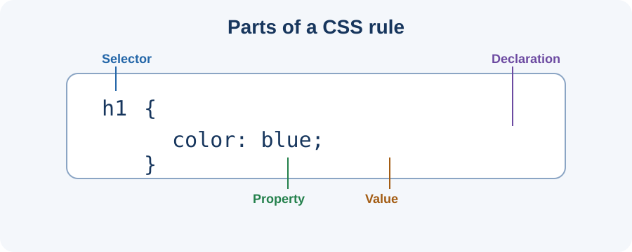

# Day 11 Practical Exercises — Connect Your First Stylesheet

## Goal
Create an external CSS file and use it to style a simple HTML page.

## Part A — Open your project
1. Open VS Code.
2. Open your Week 2 profile project folder.
3. Find the HTML file in Explorer. If needed, use the supplied example.

## Part B — Create the stylesheet
1. Create a new file beside `index.html`.
2. Name it exactly `styles.css`.
3. Type and save:

```css
body {
  background-color: #f2f6fb;
  color: #243247;
}
```

## Part C — Connect it
Inside the HTML `head`, add:

```html
<link rel="stylesheet" href="styles.css">
```

Save the HTML file. Open or refresh it in Chrome. Confirm that the background and text colour change.

## Part D — Add styles
Add these rules to `styles.css`:

```css
h1 {
  color: #174a7e;
  text-align: center;
}
p {
  font-size: 18px;
}
```

Save and check the browser.

## Part E — Independent task
Create a welcome page for a fictional learning academy. Include one heading, two paragraphs, one external stylesheet, a background colour, a different heading colour, and readable paragraph text.

## Checklist
- [ ] File is named `styles.css`.
- [ ] CSS file is beside the HTML file.
- [ ] Link is inside `head`.
- [ ] Background and heading styles are visible.
- [ ] Both files are saved.

## Troubleshooting
Check spelling and capital letters, folder location, `href`, braces, colons, semicolons, saving, and browser refresh.

## Optional challenge
Create a second HTML page and connect the same stylesheet.

**Expected result:** A styled welcome page using a separate CSS file.

## Visual reference



*Use the diagram to identify selector, property, and value.*
