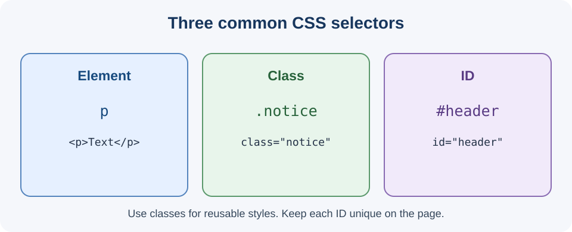

# Day 12 Lecture Notes — Selectors, Colours, and Typography

## 1. Review a CSS rule
A rule contains a selector and declarations:
```css
p { color: #333333; }
```
The selector chooses elements. A declaration contains a property and value.

## 2. Element selectors
An element selector uses an HTML tag name:
```css
p { color: #333333; }
h1 { font-size: 32px; }
```
The first rule affects all paragraphs. The second affects all level-one headings.

## 3. Class selectors
A class is a reusable label in HTML. In CSS, its selector begins with a dot.
```html
<p class="notice">Read this message.</p>
<article class="course-card">HTML Basics</article>
```
```css
.notice { color: #174a7e; }
.course-card { background-color: white; }
```
Several elements can share a class. Use meaningful names such as `course-card`, `notice`, or `page-title`. The dot is used in CSS, not in the HTML class value.

## 4. ID selectors
An ID identifies one unique element in a page. In CSS, its selector begins with `#`.
```html
<header id="site-header">Our Academy</header>
```
```css
#site-header { background-color: #e8f1fb; }
```
Do not repeat the same ID on several elements. Use classes for reusable visual styles.

## 5. Compare selectors
| Type | CSS selector | HTML example |
|---|---|---|
| Element | `p` | `<p>Text</p>` |
| Class | `.notice` | `<p class="notice">Text</p>` |
| ID | `#main-title` | `<h1 id="main-title">Title</h1>` |

## 6. Colour values
CSS supports named colours, hexadecimal values, and RGB values.
```css
h1 { color: navy; }
p { color: #333333; }
.notice { background-color: rgb(232, 241, 251); }
```
A common hex format is `#RRGGBB`. The `color` property changes text colour. The `background-color` property changes an element's background.

## 7. Choose readable colours
- Use dark text on a light background, or light text on a dark background.
- Avoid pale text on a white background.
- Keep the main palette small and consistent.
- Do not use colour alone to communicate an important message.
- Check the page on a real screen.

Example palette:
```css
body { color: #243247; background-color: #f4f7fb; }
h1, h2 { color: #174a7e; }
.notice { background-color: #e8f1fb; }
```

## 8. Typography
Typography is the way text is styled and arranged.

### Font family
`font-family` chooses the typeface. A font stack gives alternatives:
```css
body { font-family: Arial, Helvetica, sans-serif; }
```

### Font size
`font-size` changes text size:
```css
h1 { font-size: 32px; }
p { font-size: 18px; }
```
Create a clear difference between headings and paragraph text.

### Font weight
`font-weight` changes how bold text appears. Common values are 400 (normal) and 700 (bold):
```css
h2 { font-weight: 700; }
p { font-weight: 400; }
```

### Line height
`line-height` controls the vertical space between lines:
```css
p { line-height: 1.6; }
```
A value around 1.5–1.7 is often comfortable for paragraphs.

### Text alignment
```css
h1 { text-align: center; }
p { text-align: left; }
```
Short headings may be centered. Long paragraphs are usually easier to read when left aligned.

## 9. Grouping selectors
Separate selectors with commas to give them the same declarations:
```css
h1, h2, h3 { color: #174a7e; }
```

## 10. Selecting an element inside a class
A space between selectors means the second element is inside the first:
```css
.course-card h2 { color: #174a7e; }
```
This selects an `h2` inside an element with class `course-card`.

## 11. Common mistakes
- Writing `notice` instead of `.notice` in CSS.
- Writing `#main-title` in HTML instead of `id="main-title"`.
- Repeating an ID.
- Using too many colours.
- Making text too small or hard to read.
- Forgetting to save the stylesheet.

## 12. Recap
Element selectors target tag names; class selectors begin with a dot; ID selectors begin with a hash. Classes are reusable. Use a small colour palette and readable font size, weight, and line height.

## 13. Check your understanding
1. How do you write a class selector?
2. How do you write an ID selector?
3. Can several elements share one class?
4. Which property changes the space between lines?
5. Why is colour contrast important?

## Teaching visual



*Diagram: element, class, and ID selector patterns.*
