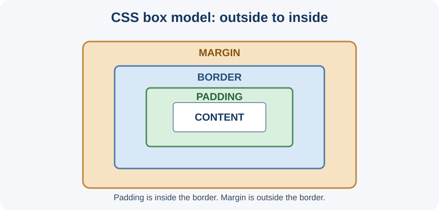

# Day 13 Instructor Guide — The CSS Box Model

## Purpose
Students can now style text and colours. This lesson explains why elements have space around them and how to control card size and spacing.

## Prepare
- Test the Day 13 example in Chrome.
- Prepare a card with no padding, border, or margin and a second styled card.
- Display the box-model diagram.
- Make sure students can edit their external stylesheet.

## Outcomes
Students identify content, padding, border, and margin; use width/max-width; center a card; and explain `box-sizing: border-box`.

## 120-minute plan
| Minutes | Activity |
|---:|---|
| 0–20 | Explain the four box-model layers using a real card or drawn rectangle |
| 20–24 | Quick vocabulary review |
| 24–54 | Demonstrate padding, border, margin, max-width, auto margins, and box sizing |
| 54–116 | Students build and adjust a centered information card |
| 116–120 | Students point to each box-model part and explain the difference between margin and padding |

## Demonstration sequence
1. Show a plain card and identify its content.
2. Add padding and show how text moves inside the card.
3. Add a border.
4. Add margin and show space outside the border.
5. Add `max-width` and `margin: 20px auto`.
6. Add `* { box-sizing: border-box; }` and explain the predictable width.
7. Change values one at a time so students can see cause and effect.

## Questions
- Which layer is closest to the content?
- Is margin inside or outside the border?
- What does border do?
- Why might a fixed height be a problem for a text card?
- What does auto margin do when a block has a max-width?

## Common mistakes
| Mistake | Response |
|---|---|
| Confuses margin and padding | Draw the box layers and point to inside/outside |
| Border not visible | Check border style, width, and colour |
| Card does not center | Check block width/max-width and available space |
| Text is cut off | Remove fixed height and allow content to grow |
| Card wider than expected | Explain content-box versus border-box |

## Support and extension
Support: give a card rule with blanks for padding, border, and margin. Core: build a centered card. Extension: create two cards with different spacing and compare.

## Checkpoint
Each student can show content, padding, border, and margin in their own card and explain one reason to use `box-sizing: border-box`.

## Teaching visual

*Use the nested layers to explain the box model from outside to inside.*
