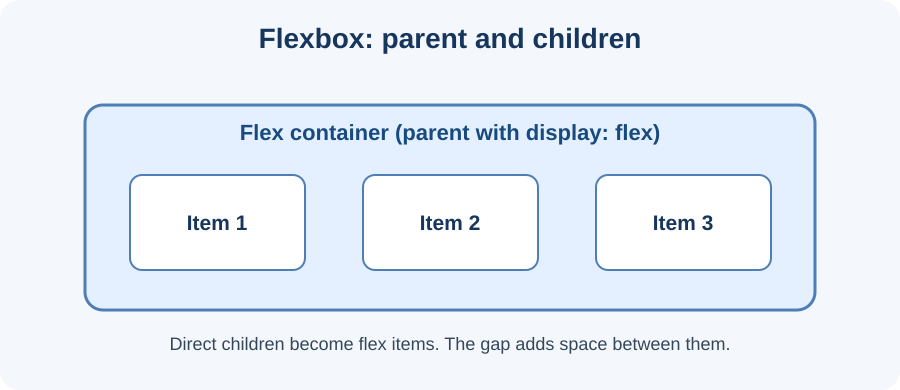

# Day 14 Practical Exercises — Navigation and Cards with Flexbox

## Goal
Use Flexbox to arrange navigation links and academy course cards.

## Part A — Create navigation
Add this HTML:
```html
<nav class="main-nav">
  <a href="#home">Home</a>
  <a href="#courses">Courses</a>
  <a href="#about">About</a>
</nav>
```
Add this CSS:
```css
.main-nav {
  display: flex;
  justify-content: space-between;
  align-items: center;
  gap: 16px;
}
```
Save and inspect the row.

## Part B — Experiment with alignment
Change `justify-content` to `center`, then `flex-start`, then `space-between`. Observe where the links move. Restore the value you prefer.

## Part C — Create a card group
Add a parent with three course cards:
```html
<section class="course-list">
  <article class="course-card"><h2>HTML</h2><p>Structure pages.</p></article>
  <article class="course-card"><h2>CSS</h2><p>Style pages.</p></article>
  <article class="course-card"><h2>JavaScript</h2><p>Add interaction.</p></article>
</section>
```
Add:
```css
.course-list {
  display: flex;
  flex-wrap: wrap;
  gap: 16px;
}
.course-card {
  flex: 1 1 220px;
  padding: 18px;
  border: 1px solid #d5deea;
}
```

## Part D — Independent task
Build a simple academy information section with:
- a navigation row,
- at least three course cards,
- Flexbox on the correct parent elements,
- a visible gap between items,
- wrapping enabled for the card group.

## Checklist
- [ ] `display: flex` is on the parent.
- [ ] I can identify the flex items.
- [ ] Navigation links appear in a row.
- [ ] Cards have a gap.
- [ ] Cards can wrap when space is limited.

## Troubleshooting
Check that the parent has `display: flex`. Check that you added `gap` to the container. For cards, check `flex-wrap: wrap` and the card's flex basis.

## Optional challenge
Change the card group to `flex-direction: column` and describe how the main and cross axes change.

**Expected result:** A navigation row and a group of cards arranged with Flexbox.

## Visual reference



*Use the diagram to identify the parent flex container and child items.*
