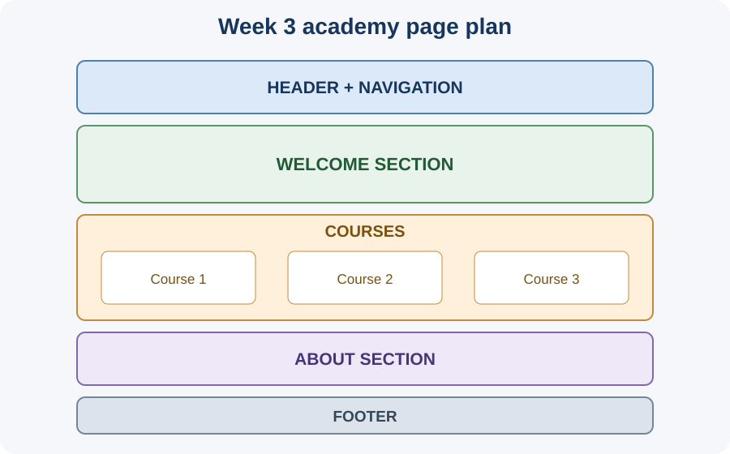

# Day 15 Instructor Guide — Academy Information Website

## Teaching purpose
This session consolidates Week 3 CSS skills in one guided project. Students should combine existing knowledge rather than learn several new CSS concepts.

## Prepare
- Test the supplied project example.
- Prepare a simple page plan/wireframe.
- Ensure students have their Week 2 HTML profile project or starter HTML.
- Display the project structure diagram.
- Remind students that responsive design is Week 4.

## Outcomes
Students build an academy information page using semantic HTML, external CSS, selectors, a small colour palette, typography, box-model spacing, and Flexbox.

## 120-minute plan
| Minutes | Activity |
|---:|---|
| 0–20 | Explain project requirements and sketch the page structure |
| 20–24 | Review the CSS tools students will use |
| 24–54 | Demonstrate building the header, sections, cards, and footer; apply CSS |
| 54–116 | Students build their own academy page with instructor support |
| 116–120 | Peer review and quick explanation of CSS choices |

## Guided demonstration
1. Sketch the page: header/nav, welcome, course cards, about, footer.
2. Build semantic HTML sections and in-page links.
3. Add reusable `course-card` classes.
4. Connect an external stylesheet.
5. Apply typography and colours.
6. Add padding, border, and margin.
7. Use Flexbox for navigation and cards.
8. Click links and inspect the page in Chrome.

## Questions
- Which parts are HTML structure?
- Why do all cards share a class?
- What is the difference between padding and margin?
- Which element is the flex container?
- How can you test an in-page navigation link?

## Common problems
| Problem | Response |
|---|---|
| Page is one long block | Break it into meaningful sections |
| Navigation link does not work | Match href fragment to a unique section ID |
| Cards look different | Reuse one class |
| CSS not loading | Check external link and path |
| Cards do not line up | Check parent `display: flex` and gap |
| Page not mobile-friendly | Explain this is a Week 4 learning target; record observations |

## Differentiation
Support: provide the HTML structure and ask students to complete the CSS. Core: complete all required sections and three cards. Extension: add a simple hover state to navigation links or cards, without using JavaScript.

## Assessment/checkpoint
Check:
- Semantic page sections and clear headings.
- Working in-page navigation.
- External stylesheet.
- Reusable classes and consistent colours.
- Readable typography.
- Correct padding, border, and margin.
- Flexbox on the correct parent.
- Student can explain one selector, one box-model property, and one Flexbox property.

Do not grade responsive media queries in this week; those are taught next week.

## Teaching visual

*Project this wireframe while students plan their page sections.*
