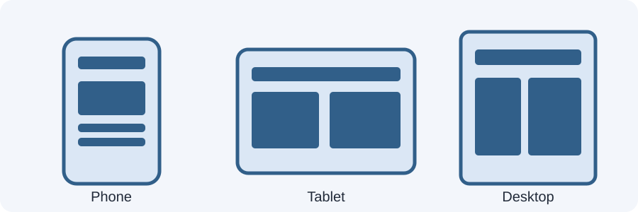

# Day 16 Instructor Guide — Responsive Design: The Big Picture

## Teaching purpose
Connect Week 3 CSS skills to the real problem of different screen widths. Students should understand the problem before learning media-query syntax.

## Prepare before class
- Open `examples/index.html` in Chrome.
- Confirm Chrome DevTools is available.
- Project the page at desktop width, then switch to a narrow viewport.
- Draw or display `images/day-16-responsive-screens.svg`.
- Ask students to open their Week 3 academy page if available.

## Learning outcomes
Students explain responsive design and viewport, identify fixed-width overflow, add the viewport meta tag, and inspect a page at three widths.

## 120-minute plan
| Time | Activity |
|---|---|
| 20 min | Explain responsive design, viewport, fixed/flexible layout |
| 4 min | Ask five quick recall questions |
| 30 min | Demonstrate DevTools device toolbar and compare layouts |
| 62 min | Students inspect, record, and fix layout problems |
| 4 min | Exit check and review |

## Instructor demonstration
1. Show the page at a wide width.
2. Open DevTools device toolbar.
3. Set width to approximately 375px.
4. Point out horizontal scrolling and cramped content in the fixed panel.
5. Compare the flexible panel.
6. Open the HTML head and show the viewport meta tag.
7. Change width to approximately 768px and 1280px.

## Explain carefully
- Responsive design is a way of thinking and a set of techniques, not a separate language.
- Device toolbar simulates viewport dimensions; it does not perfectly reproduce every real device.
- The viewport meta tag is important, but it does not automatically make a page responsive.
- Avoid giving students a long list of device-specific breakpoints today.

## Questions to ask
- What changed when we narrowed the browser?
- Which element caused sideways scrolling?
- Why should a page not assume every visitor has a large monitor?
- Does the viewport tag fix all layout problems? Why not?

## Common mistakes
- Students confuse the physical screen with the browser viewport.
- Students think the viewport tag alone creates responsive layouts.
- Students only test a single device preset.
- Students use browser zoom instead of changing viewport width.

## Support and extension
**Support:** Provide a screenshot and ask students to circle overflow and cramped elements.
**Extension:** Let confident students compare a real phone browser with Chrome's device toolbar.

## Assessment checkpoint
Each student demonstrates three widths and explains one issue and one possible fix.