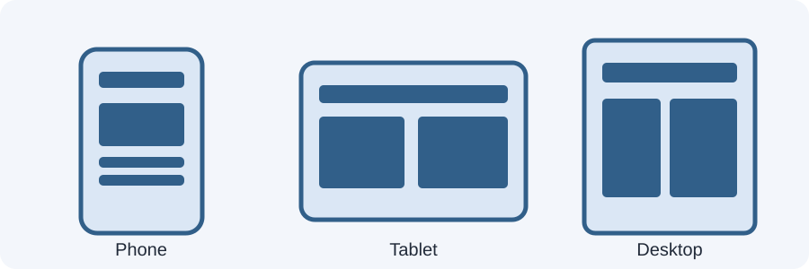

# Day 16 Lecture Notes — Responsive Design: The Big Picture



## 1. What is responsive web design?
Responsive web design (RWD) is an approach to building pages that remain readable and usable on different screen sizes. A page should adapt when it is viewed on a phone, tablet, laptop, or large monitor.

Responsive does not mean making every device look exactly the same. It means arranging the same content in a way that suits the available space.

## 2. What is a viewport?
The viewport is the visible area of a web page inside the browser window. Its width changes when the browser window or device changes.

A 375px-wide phone viewport has much less horizontal space than a 1280px desktop viewport.

## 3. Why fixed-width layouts fail
A rule such as `width: 1000px;` can force a small screen to scroll sideways. Text and cards may become too narrow, overlap, or disappear beyond the edge.

Prefer flexible widths and sensible maximum widths:
```css
.container {
  width: 90%;
  max-width: 1100px;
  margin: 0 auto;
}
```
The container can shrink on a phone but will not become endlessly wide on a large monitor.

## 4. Flexible content
A flexible layout uses available space rather than demanding one exact width. Percentages, max-width, Flexbox, and Grid help content adapt.

For this week, students will practise:
- A readable content container.
- Images that stay inside their parent.
- Cards that move from one column to multiple columns.
- Navigation that fits narrow screens.

## 5. The viewport meta tag
Place this line inside the `<head>` of every responsive HTML page:
```html
<meta name="viewport" content="width=device-width, initial-scale=1.0">
```
It tells mobile browsers to use the device's actual viewport width and a normal initial scale. Without it, mobile browsers may use a wider layout viewport and make the page appear zoomed out.

## 6. Inspecting screen sizes in Chrome
1. Open the page in Chrome.
2. Right-click and choose Inspect, or press F12.
3. Select the device toolbar icon (phone/tablet) in DevTools.
4. Choose a device preset or enter a custom width.
5. Test around 375px, 768px, and 1280px.
6. Watch for horizontal scrolling, tiny text, cramped buttons, and broken navigation.

Device presets are examples, not the only screen sizes that matter. A page should work across a range of widths.

## 7. Common responsive problems
- Fixed-width containers wider than the screen.
- Images wider than their parent.
- Cards that never wrap.
- Navigation links that run off the edge.
- Text lines that are too long on large displays or too cramped on small ones.
- Buttons too close together to tap comfortably.

## 8. First responsive safety rules
```css
* {
  box-sizing: border-box;
}

img {
  max-width: 100%;
  height: auto;
}
```
The universal box-sizing rule makes width calculations easier. The image rule prevents images from exceeding their container while preserving their proportions.

## 9. Guided example
Open `examples/index.html`. Compare the fixed-width panel with the flexible panel. Resize the viewport and note which one creates horizontal overflow.

## 10. Key vocabulary
- **Responsive design:** layout adapts to available screen space.
- **Viewport:** visible browser area for the page.
- **Fixed width:** an exact width that does not naturally shrink.
- **Flexible width:** a width that can adapt.
- **Overflow:** content extends beyond its container.
- **Device toolbar:** Chrome DevTools feature for simulating viewport sizes.

## 11. Remember
Do not design only for one phone model. Make the layout work at narrow, medium, and wide widths. Choose layout changes based on when the content needs more space, not on a device brand.