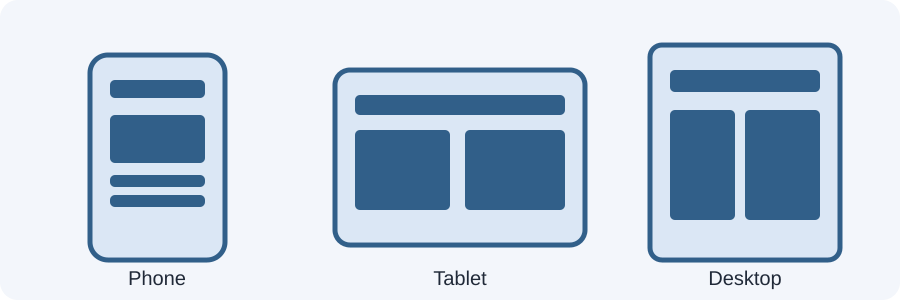

# Day 16 Practical Exercises — Inspect Responsive Layouts

## Before you start
Open the `day-16-responsive-design-introduction` folder in VS Code. Open `examples/index.html` with Live Server.

## Exercise 1 — Inspect a wide screen (10 minutes)
1. View the page at approximately 1280px wide.
2. Find the fixed-width panel and flexible panel.
3. Write down how each panel looks.

## Exercise 2 — Inspect a phone width (15 minutes)
1. Open Chrome DevTools with F12.
2. Turn on the device toolbar.
3. Set the viewport to 375px wide.
4. Check for horizontal scrolling.
5. Record which panel causes trouble.

## Exercise 3 — Inspect a tablet width (10 minutes)
1. Set the viewport to 768px.
2. Compare the panels again.
3. Record what becomes easier to read.

## Exercise 4 — Add the viewport meta tag (10 minutes)
Open the example HTML and confirm this line appears inside `<head>`:
```html
<meta name="viewport" content="width=device-width, initial-scale=1.0">
```
If it is missing, add it and save.

## Exercise 5 — Make the image flexible (10 minutes)
Add this rule to the stylesheet:
```css
img {
  max-width: 100%;
  height: auto;
}
```
Resize the browser and check that the image stays inside its container.

## Required independent task (17 minutes)
Use your Week 3 academy page or today's example. Test at 375px, 768px, and 1280px. Write down:
- One problem at the smallest width.
- One problem at the medium width, if any.
- One thing that works well.
- One change you would make next.

## Checklist
- [ ] I can open Chrome DevTools.
- [ ] I can change the viewport width.
- [ ] I understand what the viewport is.
- [ ] I checked the viewport meta tag.
- [ ] My image does not overflow its parent.
- [ ] I recorded at least one responsive issue.

## Optional challenge
Change a fixed-width box to a flexible container with `width: 90%` and `max-width: 1100px`.

## Troubleshooting
- If DevTools is hidden, press F12 and select the phone/tablet icon.
- If Live Server does not open, right-click the HTML file and choose Open with Live Server.
- If changes do not appear, save the file and refresh the browser.
- If an image is missing, check its relative file path.