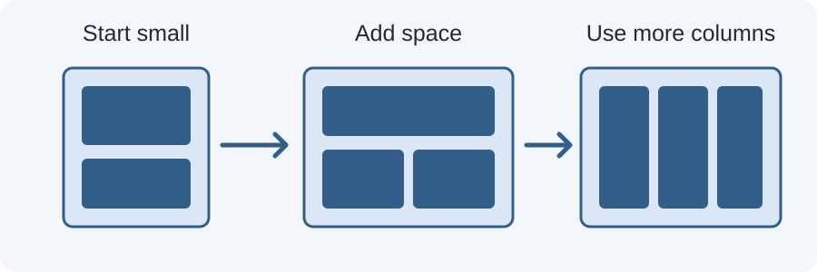

# Day 17 Lecture Notes — Mobile-First CSS and Media Queries



## 1. What does mobile-first mean?
Mobile-first means writing the basic CSS for a narrow screen first. Then use media queries to add or adjust layout when more space is available.

A simple mobile layout is often one column. A wider screen may have two or three columns.

## 2. What is a media query?
A media query applies CSS only when a condition is true. A common condition checks viewport width.

```css
@media (min-width: 700px) {
  .cards {
    grid-template-columns: repeat(2, 1fr);
  }
}
```
This rule applies when the viewport is at least 700px wide.

## 3. Mobile-first example
Start with the narrow layout:
```css
.cards {
  display: grid;
  grid-template-columns: 1fr;
  gap: 16px;
}
```
Then add a wider layout:
```css
@media (min-width: 700px) {
  .cards {
    grid-template-columns: repeat(2, 1fr);
  }
}
```
The first rule is the default. The media query enhances it for a wider viewport.

## 4. What is a breakpoint?
A breakpoint is the point where a layout needs a change to remain useful. Do not choose breakpoints only because a particular phone or tablet has a certain size. Resize the page and add a breakpoint when the content becomes cramped or too spread out.

## 5. min-width and max-width
- `min-width: 700px` means 700px or wider.
- `max-width: 699px` means 699px or narrower.

For the mobile-first approach in this course, begin with default small-screen rules and mainly add `min-width` queries.

## 6. Common mistakes
- Putting all styles inside media queries and forgetting the default mobile style.
- Writing a query without curly braces.
- Using `min-width` when you meant `max-width`.
- Testing only at the exact breakpoint.
- Adding many breakpoints without a clear layout reason.

## 7. Test around a breakpoint
If your breakpoint is 700px, test at 375px, 699px, 700px, 701px, and 900px. This helps you notice sudden overflow or awkward changes.

## 8. Guided practice
Open `examples/index.html`. The cards begin in one column. Resize the viewport to see the two-column layout begin at 700px.

## 9. Key vocabulary
Mobile-first, media query, breakpoint, viewport width, min-width, max-width, default styles.

## 10. Remember
A media query is not a magic responsive button. You must choose a useful condition and write CSS that improves the layout when that condition is true.