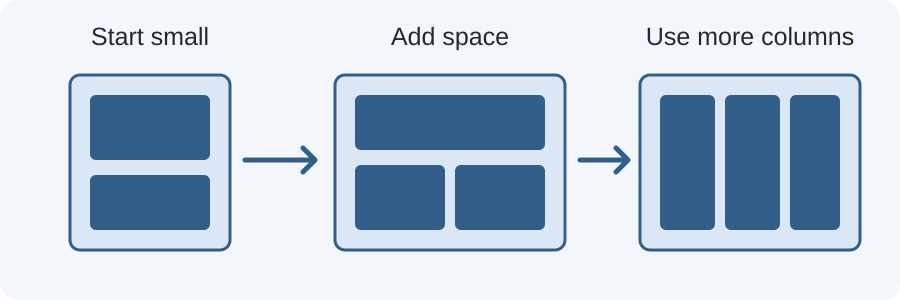

# Day 17 Practical Exercises — Your First Media Query

## Setup
Open `examples/index.html` with Live Server.

## Exercise 1 — Inspect the default layout (10 min)
1. Set Chrome to 375px wide.
2. Confirm the cards appear in one column.
3. Find the default `.cards` rule in CSS.

## Exercise 2 — Find the breakpoint (10 min)
1. Find `@media (min-width: 700px)`.
2. Read the CSS inside it.
3. Set the viewport to 699px, then 700px.
4. Describe the change.

## Exercise 3 — Change the breakpoint (10 min)
Change 700px to 750px. Save and test at 740px and 760px. Observe when the columns change.

## Exercise 4 — Add your own media query (15 min)
Add a media query that increases the page's horizontal padding when the viewport is at least 900px.

## Required independent task (17 min)
Create three simple cards. Use one column by default and two columns from a breakpoint you choose. Test below, at, and above that breakpoint.

## Checklist
- [ ] Default layout works at 375px.
- [ ] Media query uses correct syntax.
- [ ] Breakpoint has a clear purpose.
- [ ] Layout changes at the expected width.
- [ ] No horizontal overflow at 375px, 768px, or 1280px.

## Optional challenge
Add a three-column layout at a wider breakpoint.

## Troubleshooting
- Check every opening brace has a closing brace.
- Confirm the media query is outside the selector it changes.
- Save the CSS file and refresh.
- Check the stylesheet link in the HTML head.