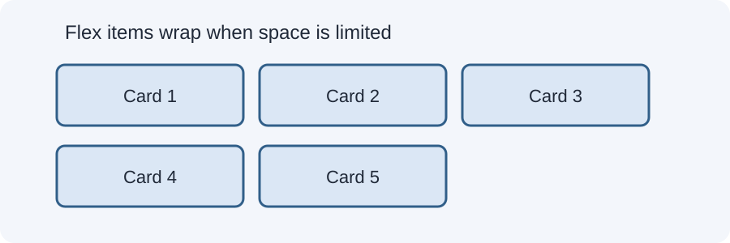

# Day 18 Lecture Notes — Responsive Flexbox


## 1. Flexbox recap
Flexbox arranges child elements along a main axis. The parent becomes a flex container with `display: flex`; its direct children become flex items.

## 2. Why wrapping matters
Without wrapping, flex items try to remain on one line. If there is not enough space, items may become cramped or overflow. `flex-wrap: wrap` allows items to move to another line.

```css
.card-row {
  display: flex;
  flex-wrap: wrap;
  gap: 16px;
}
```

## 3. Flexible card sizing
```css
.card {
  flex: 1 1 220px;
}
```
This is shorthand for grow, shrink, and basis. In this beginner example, each card can grow, can shrink, and starts with a basis of about 220px. The final size depends on available space.

A useful alternative is:
```css
.card {
  flex: 1 1 220px;
  min-width: 0;
}
```
The `min-width: 0` can allow flex items to shrink below their automatic content-based minimum when necessary. Avoid adding it without understanding what it changes.

## 4. Gap
Use `gap` to create consistent space between flex items:
```css
.card-row { gap: 16px; }
```
This is usually clearer than adding margins to every card.

## 5. Responsive navigation
A simple navigation can use Flexbox:
```css
nav ul {
  display: flex;
  flex-wrap: wrap;
  gap: 12px;
  list-style: none;
  padding: 0;
}
```
For this lesson, let links wrap naturally. A collapsible hamburger menu requires JavaScript and is outside today's lesson.

## 6. Alignment
- `justify-content` aligns items along the main axis.
- `align-items` aligns items along the cross axis.
- `flex-direction` changes the main axis direction.
- `flex-wrap` controls whether items can move onto another line.

## 7. Common mistakes
- Forgetting `display: flex` on the parent.
- Adding `flex-wrap` to the child instead of the container.
- Using a fixed width that prevents cards from shrinking.
- Confusing `justify-content` with `align-items`.
- Using a mobile menu that has no working interaction.

## 8. Guided example
Open `examples/index.html`. Resize the browser. The cards should wrap into fewer columns when space becomes limited.

## 9. Remember
Flexbox is especially useful for arranging items in one direction. Use wrapping and flexible sizing so the layout can respond naturally.