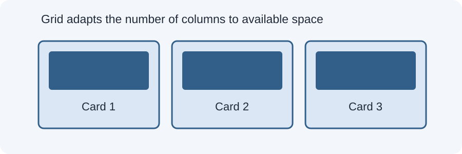

# Day 19 Lecture Notes — CSS Grid and Responsive Images



## 1. When to use CSS Grid
CSS Grid is useful when you want to arrange content in rows and columns. It works well for card collections, galleries, and page sections.

## 2. Basic grid
```css
.gallery {
  display: grid;
  grid-template-columns: 1fr;
  gap: 16px;
}
```
This starts with one column, which is a useful mobile-first default.

## 3. Add columns at a breakpoint
```css
@media (min-width: 700px) {
  .gallery {
    grid-template-columns: repeat(2, 1fr);
  }
}
```
The grid has two equal columns at 700px and wider.

## 4. A flexible grid with minmax and auto-fit
```css
.gallery {
  display: grid;
  grid-template-columns: repeat(auto-fit, minmax(220px, 1fr));
  gap: 16px;
}
```
- `minmax(220px, 1fr)` says a column should be at least 220px and may grow to share available space.
- `auto-fit` lets the browser fit as many columns as will fit in the available space.
- `1fr` means a share of the available space.

This is a powerful pattern, but students should understand the simple one-column and media-query version first.

## 5. Responsive images
Use:
```css
img {
  max-width: 100%;
  height: auto;
}
```
The image can shrink to fit its container and keeps its original proportions.

## 6. Avoid fixed image widths
A rule such as `width: 700px;` can make an image wider than a small card. Use `max-width: 100%` for general responsive behavior.

## 7. Image cropping (optional introduction)
`object-fit: cover` can fill a fixed image area by cropping part of the image. This is useful for consistent card thumbnails, but explain that cropping may hide some of the picture.

```css
.card img {
  width: 100%;
  height: 180px;
  object-fit: cover;
}
```

## 8. Common mistakes
- Forgetting `display: grid`.
- Writing columns on the grid item instead of the grid container.
- Using a minimum column width larger than the available space.
- Setting both image width and height without considering distortion.
- Using `object-fit: cover` when the whole image must remain visible.

## 9. Guided example
Open `examples/index.html`. Resize the page and observe the gallery. The grid uses `auto-fit` and `minmax()`; images remain inside each card.

## 10. Remember
Grid is useful for two-dimensional layouts. Responsive image rules help media stay inside its available space. Always test the result at more than one width.