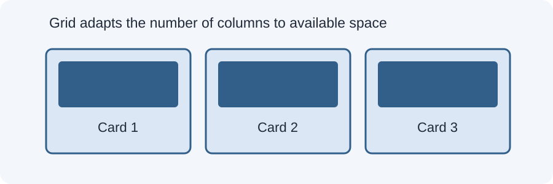

# Day 19 Practical Exercises — Grid and Images

## Exercise 1 — Create a grid (10 min)
Open today's example. Find the gallery container and identify its grid items.

## Exercise 2 — Change the gap (8 min)
Change the grid gap from 16px to 24px. Save and compare.

## Exercise 3 — Test auto-fit (12 min)
1. Find `repeat(auto-fit, minmax(220px, 1fr))`.
2. Change 220px to 260px.
3. Resize the browser.
4. Count how many columns fit.

## Exercise 4 — Make an image responsive (12 min)
Add `max-width: 100%; height: auto;` to the image rule. Test at a narrow viewport.

## Required independent task (20 min)
Create a gallery of at least three cards. Use CSS Grid and responsive images. The gallery must work at phone, tablet, and desktop widths.

## Checklist
- [ ] Gallery uses `display: grid`.
- [ ] Cards have consistent gaps.
- [ ] Grid columns adapt to available space.
- [ ] Images stay within their cards.
- [ ] Image proportions are preserved.
- [ ] No horizontal overflow at 375px.

## Optional challenge
Use `object-fit: cover` to create equal-height image thumbnails. Explain that it crops the image.

## Troubleshooting
Check the grid parent selector, the CSS file link, image paths, and minmax minimum size. Save and refresh after each change.