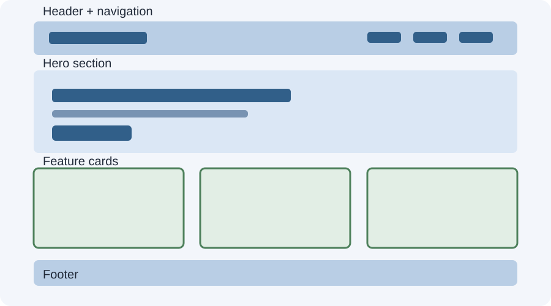

# Day 20 Instructor Guide — Responsive Landing Page

## Teaching purpose
Consolidate Week 4 skills through a small complete project. Prioritize working responsive behavior over visual complexity.

## Preparation
- Open the starter example.
- Display `images/day-20-landing-page-wireframe.svg`.
- Prepare Chrome DevTools at 375px, 768px, and 1280px.
- Review the Day 16–19 key concepts.

## Learning outcomes
Students plan a one-page layout, use mobile-first CSS, combine Flexbox/Grid, and test/fix common responsive issues.

## 120-minute plan
| Time | Activity |
|---|---|
| 20 min | Explain requirements and sketch page structure |
| 4 min | Recall responsive concepts |
| 30 min | Instructor builds a small landing page demo |
| 62 min | Students build and test their pages |
| 4 min | Review and exit check |

## Instructor demonstration
1. Sketch the four page sections.
2. Build semantic HTML structure.
3. Create a flexible centered container.
4. Style the navigation with wrapping Flexbox.
5. Create the feature cards with Grid.
6. Add a mobile-first default and a media query.
7. Test at 375px, 768px, and 1280px.
8. Demonstrate finding and fixing one overflow issue.

## Keep scope achievable
- One page only.
- No JavaScript.
- No external CSS framework or Tailwind.
- No advanced animation.
- Use simple text and optional images.
- Students may use their Week 3 academy page as a starting point.

## Common mistakes
- Starting with desktop and trying to shrink everything at the end.
- Fixed-width cards or images.
- Navigation links that overflow.
- Too many media queries.
- Adding decorative effects before fixing layout problems.

## Differentiation
**Support:** Provide a starter HTML structure and ask students to complete one section at a time.
**Extension:** Ask confident students to use auto-fit/minmax for the card grid or improve responsive typography.

## Assessment checkpoint
Check required sections, one media query, Flexbox/Grid use, and three-width testing. Ask students to explain one issue they found and fixed.