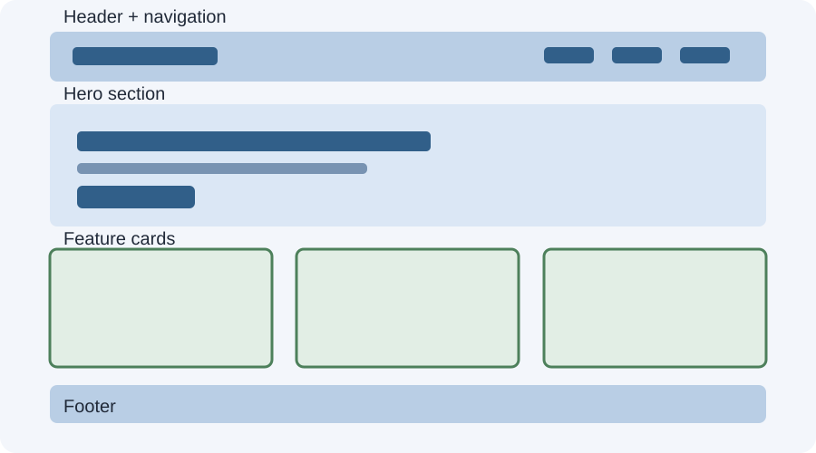

# Day 20 Lecture Notes — Responsive Landing Page



## 1. Project purpose
Today you combine the skills from Days 16–19 to build a complete one-page landing page. The content is fictional. Do not publish private contact details.

## 2. Plan before coding
Sketch four main areas:
1. Header with site name and navigation.
2. Hero section with main message and call-to-action.
3. Feature or course cards.
4. Footer.

Decide what should appear first on a phone. Keep the content order logical in the HTML.

## 3. Start with mobile CSS
Begin with a narrow layout:
```css
.container {
  width: 92%;
  max-width: 1100px;
  margin: 0 auto;
}
```
Let cards stack on small screens. Then add a media query for wider layouts.

## 4. Choose the right layout tool
- Use Flexbox for one-dimensional arrangements such as navigation links or a row of buttons.
- Use Grid for two-dimensional collections such as course cards.
- Both can be used together on one page.

## 5. Example responsive card grid
```css
.course-grid {
  display: grid;
  grid-template-columns: 1fr;
  gap: 16px;
}
@media (min-width: 700px) {
  .course-grid {
    grid-template-columns: repeat(2, 1fr);
  }
}
@media (min-width: 1000px) {
  .course-grid {
    grid-template-columns: repeat(3, 1fr);
  }
}
```

## 6. Navigation
For this beginner project, use links that wrap naturally with Flexbox. A collapsible mobile menu needs JavaScript and is not required in Week 4.

## 7. Responsive images
If you add images, use:
```css
img {
  max-width: 100%;
  height: auto;
}
```
Use descriptive alt text for meaningful images. Do not use images just to fill empty space.

## 8. Test systematically
Use Chrome DevTools device toolbar:
- 375px: narrow phone.
- 768px: tablet-like width.
- 1280px: desktop-like width.

Also test by slowly resizing the browser. Look for:
- Sideways scrolling.
- Text touching screen edges.
- Cards that are too narrow.
- Navigation links overlapping.
- Images stretching or overflowing.
- Very long lines on wide screens.

## 9. Debug responsive issues
1. Identify the element causing the issue.
2. Inspect its width, padding, margin, and parent layout.
3. Check whether a fixed width is responsible.
4. Adjust flexible sizing or add a breakpoint only if needed.
5. Test again at all three widths.

## 10. Presentation
Be ready to explain:
- What the page is for.
- Which sections it contains.
- Which layout uses Flexbox and which uses Grid.
- Where the media query changes the layout.
- What you tested and what you fixed.

## 11. Remember
A responsive page is not finished just because it looks good on your own screen. Test a range of widths and check that the content remains usable.