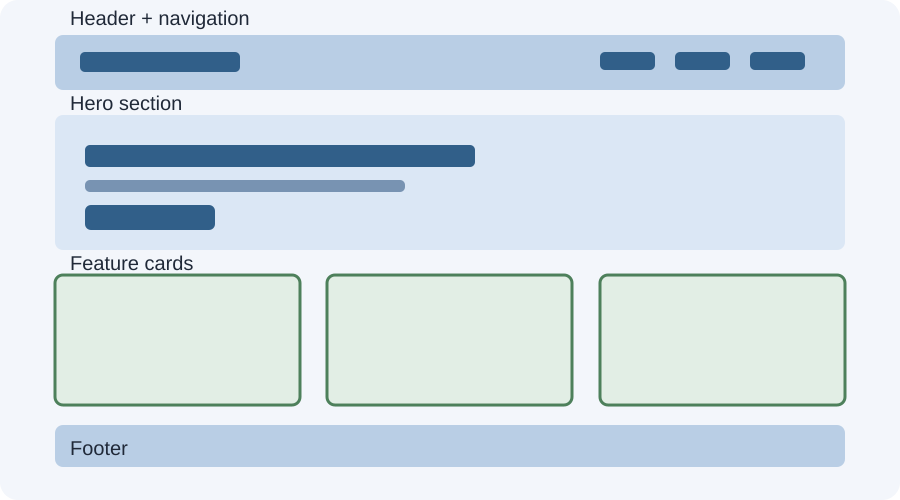

# Day 20 Practical Exercises — Build a Responsive Landing Page

## Step 1 — Plan (8 min)
Draw a simple wireframe with header, hero, cards, and footer.

## Step 2 — Build the HTML (12 min)
Create semantic sections. Add a heading, short paragraph, navigation links, and at least three cards.

## Step 3 — Add mobile-first CSS (12 min)
Set a readable font, a flexible container, spacing, and one-column card layout.

## Step 4 — Add Flexbox navigation (8 min)
Use `display: flex`, `flex-wrap: wrap`, and `gap` for navigation links.

## Step 5 — Add a responsive Grid (10 min)
Use CSS Grid for the cards. Add a media query to create more columns on wider screens.

## Step 6 — Test and fix (12 min)
Test at 375px, 768px, and 1280px. Fix any overflow, overlap, or unreadable content.

## Required project checklist
- [ ] Page has a header and navigation.
- [ ] Page has a hero section.
- [ ] Page has at least three feature/course cards.
- [ ] Page has a footer.
- [ ] Viewport meta tag is included.
- [ ] Mobile-first CSS is used.
- [ ] At least one media query is used.
- [ ] Flexbox or Grid is used appropriately.
- [ ] Images, if used, are responsive and have alt text.
- [ ] No unintended horizontal scrolling at three widths.

## Optional challenge
Add a responsive image or use `auto-fit` and `minmax()` for the card grid.

## Troubleshooting
Inspect the element causing overflow. Check fixed widths, image dimensions, padding, and the parent container. Avoid adding another media query until you understand the cause.