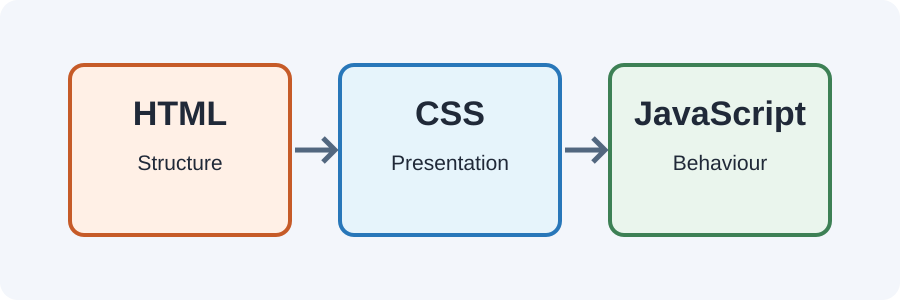

# Day 21 Lecture Notes — Introduction to JavaScript



## 1. Three main web technologies
- **HTML** describes the content and structure.
- **CSS** controls presentation and layout.
- **JavaScript** adds behaviour and logic.

For example, HTML creates a button, CSS styles it, and JavaScript can make something happen when it is clicked. Today we focus on JavaScript basics and console output; button events and page changes come in Week 6.

## 2. What is JavaScript?
JavaScript is a programming language commonly used in web browsers. A browser can run JavaScript to calculate values, make decisions, and respond to user actions.

## 3. Add JavaScript to a page
Create two files in the same project folder:
- `index.html`
- `script.js`

Add this line inside the HTML `<head>`:
```html
<script src="script.js" defer></script>
```
The `src` value must match the JavaScript filename and path. The `defer` attribute tells the browser to run the external script after the HTML has been parsed.

## 4. Your first JavaScript
In `script.js`:
```javascript
console.log("Hello, JavaScript!");
console.log("I am learning web development.");
```
Save both files and refresh the page.

## 5. Open the browser console
In Chrome:
1. Open your webpage.
2. Right-click and choose Inspect, or press F12.
3. Select the Console tab.
4. Read the messages printed by your program.

The console is a developer tool. It is not normally part of the webpage that visitors see.

## 6. Comments
Comments are notes for people reading the code. The browser does not run them as instructions.
```javascript
// This is a single-line comment
console.log("Practise a little every day");

/*
  This is a
  multi-line comment.
*/
```

## 7. JavaScript is case-sensitive
`console.log` is correct. `Console.log` is different and will not work as intended. Match uppercase and lowercase letters carefully.

## 8. Common errors
- The script filename is `scripts.js`, but HTML says `script.js`.
- The JavaScript file is in another folder and the path is incorrect.
- Changes were not saved before refreshing.
- A quote or bracket is missing.
- The student is looking at the Elements tab instead of Console.

## 9. Guided example
Open `examples/index.html` with Live Server. Open the Console tab and identify each message from `script.js`.

## 10. Remember
JavaScript can be kept in a separate `.js` file. Use the browser console to observe output and find errors. Do not worry about changing webpage elements yet; that is Week 6.