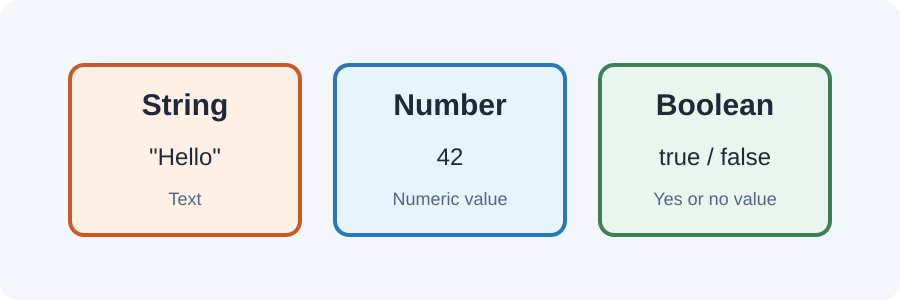

# Day 22 Practical Exercises — Variables and Operators



## Exercise 1 — Create values (10 min)
In `script.js`, declare:
```javascript
const studentName = "Student";
let studentAge = 18;
const isLearningJavaScript = true;
```
Print each value.

## Exercise 2 — Check data types (8 min)
Use `typeof` with each variable and inspect the output.

## Exercise 3 — Practise arithmetic (12 min)
Create two number variables. Print their sum, difference, product, quotient, and remainder.

## Exercise 4 — Compare values (10 min)
Use `>`, `<`, and `===` to compare two scores. Predict each result first.

## Exercise 5 — Calculate a purchase (12 min)
Use an item price and quantity to calculate a total. Print a clear message and the result.

## Required independent task (20 min)
Create a course-fee calculator using:
- Course fee.
- Number of students.
- Total fee.
- A boolean that records whether the fee is within a sample budget.

## Checklist
- [ ] Uses `const` and `let` correctly.
- [ ] Includes a string, number, and boolean.
- [ ] Uses `typeof`.
- [ ] Uses at least three arithmetic operators.
- [ ] Uses at least two comparison operators.
- [ ] Prints clear output.

## Optional challenge
Calculate a 10% discount and print the discounted total.

## Troubleshooting
Check quotes, spelling, capitalization, and whether a variable should be `const` or `let`. Read the first Console error before changing code.