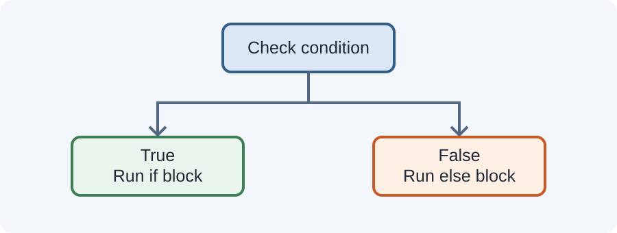

# Day 23 Instructor Guide — Conditions

## Teaching purpose
Teach decision-making using examples students can predict. Keep the first examples to one comparison and gradually introduce multiple branches.

## Prepare
- Today's example open in VS Code.
- Board space for tracing true/false outcomes.
- Sample marks: 45, 60, 79, and 85.

## Outcomes
Students write and trace `if`, `else if`, `else`, and simple logical expressions.

## 120-minute plan
20 min explanation · 4 min review · 30 min demonstration · 62 min practice · 4 min exit check.

## Demonstration sequence
1. Begin with a single `if` statement.
2. Add an `else` branch.
3. Add `else if` for three score ranges.
4. Trace the score 45, then 60, then 85.
5. Demonstrate a positive/negative/zero check.
6. Show `&&` with two conditions and explain that both must be true.
7. Ask students to predict output before each run.

## Teaching cautions
- Focus on simple conditions; do not introduce switch statements or ternary expressions.
- Explain comparison versus assignment.
- Emphasise condition order and boundary values.
- Keep logical expressions short and readable.

## Common mistakes
- Missing braces or parentheses.
- Incorrect condition order.
- Off-by-one boundaries.
- Using `||` when both conditions are required.
- Not testing values exactly at a boundary.

## Support and extension
**Support:** Provide a flowchart or a partially completed if/else structure.
**Extension:** Ask students to check whether a number is within a range using `&&`.

## Checkpoint
Student correctly predicts and explains the branch for a value below, at, and above the sample pass mark.