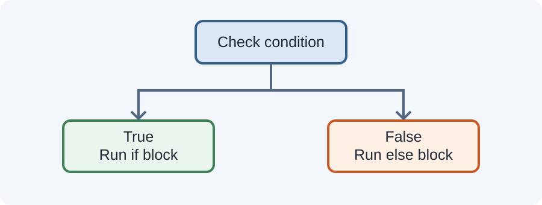

# Day 23 Practical Exercises — Making Decisions

## Exercise 1 — One condition (8 min)
Check whether a number is greater than 10. Print a message only when the condition is true.

## Exercise 2 — if and else (10 min)
Check whether a fictional student has reached 60 marks. Print "Pass" or "Keep practising".

## Exercise 3 — Three branches (12 min)
Use `if`, `else if`, and `else` to classify a number as positive, negative, or zero.

## Exercise 4 — Score ranges (12 min)
Use these sample categories:
- 80 or above: Excellent.
- 60 to 79: Pass.
- Below 60: Keep practising.

Test 45, 60, 79, and 80.

## Exercise 5 — Logical AND (8 min)
Check whether a number is between 1 and 10 inclusive using `>=`, `<=`, and `&&`.

## Required independent task (20 min)
Create a simple eligibility checker using two conditions, such as a sample age and permission flag. Use fictional values and print a clear result.

## Checklist
- [ ] Uses `if`.
- [ ] Uses `else`.
- [ ] Uses `else if`.
- [ ] Uses comparison operators.
- [ ] Uses `&&` or `||` correctly.
- [ ] Tests boundary values.

## Optional challenge
Add a second range category and explain why the condition order matters.

## Troubleshooting
Check the braces, parentheses, comparison signs, and order of branches. Trace each condition by hand before changing code.