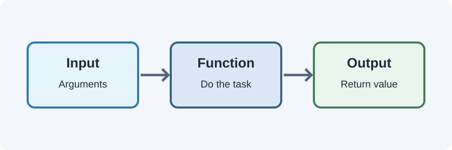

# Day 24 Instructor Guide — Functions

## Teaching purpose
Help students reuse code and separate a task into small named steps. Make the difference between parameters, arguments, and returned values visible.

## Prepare
- Open today's example.
- Prepare a simple addition example.
- Review variables, arithmetic, and conditions from Days 22–23.

## Outcomes
Students declare and call functions, pass arguments, and return results.

## 120-minute plan
20 min explanation · 4 min review · 30 min demo · 62 min practice · 4 min exit check.

## Demonstration sequence
1. Write a function with no parameters.
2. Call the function and observe its output.
3. Add one parameter and call it with two different arguments.
4. Add a second parameter.
5. Return the result of an addition.
6. Store the returned result in a variable.
7. Compare `return` with `console.log()`.
8. Build separate add, subtract, and multiply functions.

## Teaching cautions
- Teach regular function declarations only.
- Do not introduce arrow functions, callbacks, or scope rules in depth.
- Distinguish parameter names from argument values.
- Ensure students understand that a function must be called to run.

## Common mistakes
- Missing parentheses on a function call.
- Typing the wrong parameter name.
- Forgetting `return`.
- Confusing printing a result with returning a result.
- Calling a function before understanding its inputs.

## Support and extension
**Support:** Give a function template with blanks for the name, parameters, and return expression.
**Extension:** Ask students to create a function that calculates a discount or returns the larger of two numbers.

## Checkpoint
Student explains the parameter and argument in a function call and shows where its returned value is used.