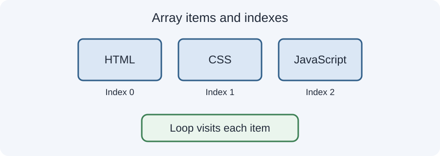

# Day 25 Instructor Guide — Arrays, Loops and Guided Calculator

## Teaching purpose
Introduce collections and repetition, then consolidate the week's skills in a guided calculator. Keep the loop example short and trace it slowly.

## Prepare
- Open today's example in VS Code.
- Prepare a three-item array on the board.
- Prepare calculator test values: 20 and 5, then 20 and 0.
- Review variables, operators, conditions, and functions.

## Outcomes
Students create an array, access items by index, trace a for loop, and explain a calculator with four functions.

## 120-minute plan
| Time | Activity |
|---|---|
| 20 min | Explain arrays, indexes, length, and loops |
| 4 min | Review variables, conditions, and functions |
| 30 min | Demo array traversal and calculator functions |
| 62 min | Guided student coding and testing |
| 4 min | Review and exit check |

## Demonstration sequence
1. Create an array of three subjects.
2. Read the first, second, and third items by index.
3. Show that the first index is 0.
4. Print the array length.
5. Write a for loop and trace index values 0, 1, and 2.
6. Explain the loop stop condition.
7. Review the add, subtract, and multiply functions.
8. Add a divide function with a zero check.
9. Change the test values and run the program again.

## Teaching cautions
- Teach only a basic indexed `for` loop; avoid nested loops and advanced array methods.
- Do not introduce `forEach`, `map`, `filter`, or destructuring.
- The calculator is console-based; do not add DOM, buttons, or form events.
- Make the zero-divisor case explicit and test it.

## Common mistakes
- Confusing array index with item count.
- Using an index equal to array.length.
- Forgetting index++.
- Creating an infinite loop.
- Not checking for a zero divisor.

## Support and extension
**Support:** Give a loop with one missing part and ask students to fill it in.
**Extension:** Add a function that returns the larger of two numbers, or loop through an array of sample marks and print each one.

## Checkpoint
Student shows a three-item array, explains the loop's three iterations, and demonstrates calculator division with a non-zero and zero divisor.