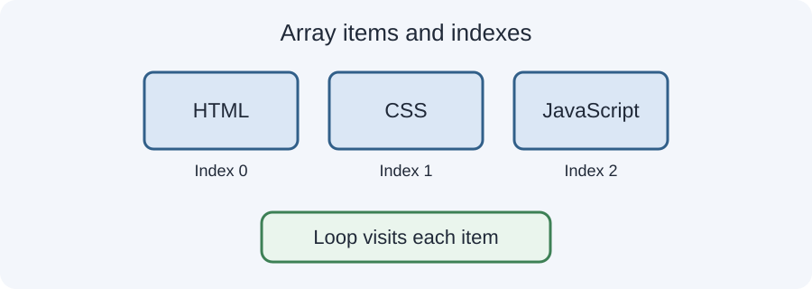

# Day 25 Lecture Notes — Arrays, Loops and Calculator



## 1. What is an array?
An array stores multiple values in one variable. Example:
```javascript
const subjects = ["HTML", "CSS", "JavaScript"];
console.log(subjects);
``

## 2. Array indexes
Each item has a position called an index. JavaScript arrays start counting at index 0.
```javascript
console.log(subjects[0]); // HTML
console.log(subjects[1]); // CSS
console.log(subjects[2]); // JavaScript
``
The first item is at index 0, the second at index 1, and so on.

## 3. Array length
The `length` property tells us how many items are in the array.
```javascript
console.log(subjects.length); // 3
``

## 4. Why use a loop?
A loop repeats instructions. It is useful when you want to perform the same task for each item in an array.

## 5. A basic for loop
```javascript
for (let index = 0; index < subjects.length; index++) {
  console.log(subjects[index]);
}
``
Understand each part:
- `let index = 0`: start at the first item.
- `index < subjects.length`: continue while the index is less than the item count.
- `index++`: increase the index by one after each repetition.
- `subjects[index]`: read the current item.

## 6. Trace the loop
For an array with three items, the index values are 0, 1, and 2. When index becomes 3, the condition `3 < 3` is false, so the loop stops.

## 7. Calculator functions
A calculator can use separate functions for each operation.
```javascript
function add(a, b) {
  return a + b;
}

function subtract(a, b) {
  return a - b;
}

function multiply(a, b) {
  return a * b;
}
``

## 8. Safe division
Division by zero is not a useful calculator result. Check the divisor first:
```javascript
function divide(a, b) {
  if (b === 0) {
    return "Cannot divide by zero.";
  }
  return a / b;
}
``

## 9. Put the program together
```javascript
const firstNumber = 20;
const secondNumber = 5;

console.log("Add:", add(firstNumber, secondNumber));
console.log("Subtract:", subtract(firstNumber, secondNumber));
console.log("Multiply:", multiply(firstNumber, secondNumber));
console.log("Divide:", divide(firstNumber, secondNumber));
``
Change the two number values and run the program again.

## 10. Common mistakes
- Trying to read an array item using an index that does not exist.
- Starting the loop at 1 and missing the first item.
- Using `<= array.length` and going one step too far.
- Forgetting to increase the loop index.
- Dividing by zero without checking.
- Mixing calculator logic with webpage buttons before learning DOM events.

## 11. Guided project
Open `examples/index.html` and inspect `script.js`. First trace the subject loop. Then test the calculator with normal values and with the second number set to zero.

## 12. Remember
Arrays group related values, loops repeat work, and functions keep calculator operations organised. This lesson uses the Console; webpage controls will be added in Week 6.