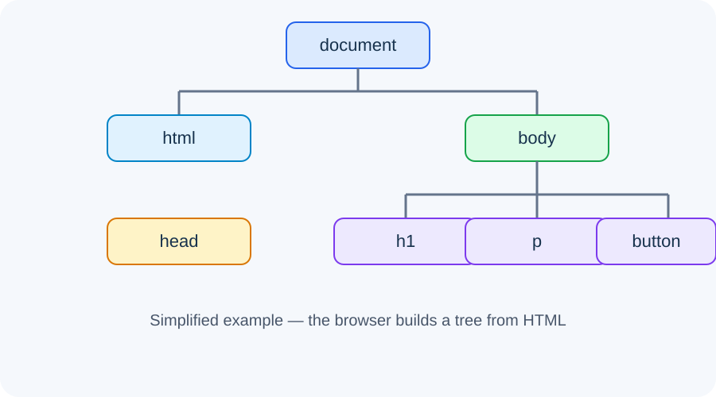

# Day 26 Lecture Notes — DOM Introduction and Selecting Elements

## 1. What changes on a webpage?
HTML describes content and structure. CSS controls appearance. JavaScript can respond to actions and update content while the page is open. A button can change a heading without loading a new page.

## 2. What is the DOM?
DOM means **Document Object Model**. When a browser loads HTML, it creates a structured representation of the document. JavaScript can use the DOM to find elements and work with them.

Think of the DOM as a tree: document at the start; html contains head and body; body contains headings, paragraphs, buttons, and other elements.

## 3. The document object
The browser provides a document object. It represents the current webpage.

~~~js
console.log(document);
~~~

Open Chrome DevTools with F12, choose Console, and try this command.

## 4. Select an element by ID
Give an HTML element a unique ID:

~~~html
<h1 id="page-title">My Website</h1>
~~~

Find it in JavaScript:

~~~js
const title = document.getElementById("page-title");
console.log(title);
~~~

An ID should identify one element on the page. Do not repeat the same ID.

## 5. Select with querySelector
querySelector() finds the first element that matches a CSS selector.

~~~js
const title = document.querySelector("#page-title");
const firstParagraph = document.querySelector("p");
const card = document.querySelector(".card");
~~~

- #page-title selects an ID.
- .card selects a class.
- p selects a paragraph element.

## 6. Read and change text
The textContent property reads or replaces the text inside an element.

~~~js
const message = document.querySelector("#message");
console.log(message.textContent);
message.textContent = "The page has been updated!";
~~~

This changes the page currently displayed in the browser. It does not edit the HTML file saved on the computer.

## 7. Connect JavaScript to HTML
Organise files in one project folder:

~~~text
dom-practice/
├── index.html
├── styles.css
└── script.js
~~~

Link JavaScript in the head using defer:

~~~html

~~~

The defer attribute tells the browser to run the script after the HTML has been parsed. Check the file path carefully.

## 8. A first interactive example
HTML:

~~~html

Welcome to the page.

<button id="change-button" type="button">Change message</button>
~~~

JavaScript:

~~~js
const message = document.getElementById("message");
const button = document.getElementById("change-button");

button.addEventListener("click", function () {
  message.textContent = "You clicked the button!";
});
~~~

The event listener is previewed here. Day 28 explains events in detail.

## 9. Common mistakes
- ID spelling in JavaScript does not match HTML.
- Using # inside getElementById(). Use "message", not "#message".
- Using querySelector("message") for an ID; use querySelector("#message").
- Script filename or path is incorrect.
- Script runs before target HTML is ready because defer is missing.
- Selecting an element that does not exist.

## 10. Debugging checklist
1. Save both files.
2. Confirm the JavaScript filename and path.
3. Confirm the HTML ID spelling.
4. Refresh the browser.
5. Open DevTools Console and read the first error.
6. Check whether the selected element is null.

## 11. Quick review
1. What does DOM stand for?
2. What does the document object represent?
3. How do you select ID notice using getElementById()?
4. What does querySelector(".box") select?
5. Which property changes text inside an element?

## Further reading
[MDN — Introduction to the DOM](https://developer.mozilla.org/en-US/docs/Web/API/Document_Object_Model/Introduction)
