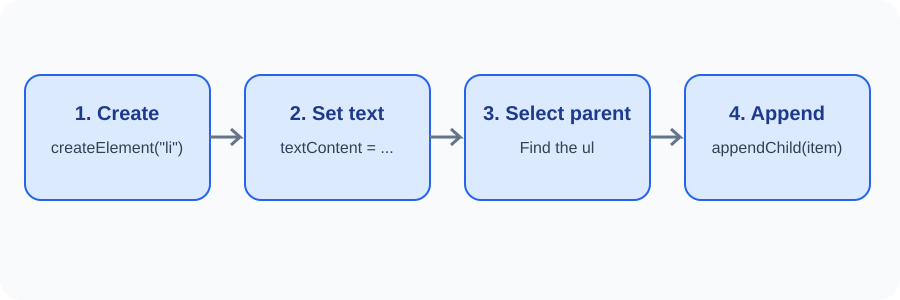

# Day 27 Instructor Guide — Changing Content and Elements

## Preparation
Test the example in Chrome. Ensure the stylesheet defines the highlight class. Prepare a list element and two buttons.

## Outcomes
Students update text and attributes, use classList, create a list item, append it, and remove an element.

## 120-minute plan
| Time | Activity |
|---|---|
| 0–20 min | Explain text, attributes, classes, and dynamic elements |
| 20–24 min | Theory review |
| 24–54 min | Demonstrate textContent, classList, createElement, append, remove |
| 54–116 min | Practical exercises |
| 116–120 min | Student demonstration and review |

## Demonstration
1. Select the message and change its text.
2. Read an attribute with getAttribute().
3. Add and remove the highlight class.
4. Create an li element.
5. Set its text with textContent.
6. Append it to the ul.
7. Remove the selected item.
8. Refresh and explain why temporary changes disappear.

## Visual teaching aid
Use images/day-27-create-append-flow.svg. Emphasise the sequence: create, set safe text, select parent, append.

## Questions
- Why does creating an element not automatically show it?
- What is the parent of an li?
- Why is textContent safer for plain user text than inserting an HTML string?
- What is the difference between removing a class and removing an element?

## Common errors
- Missing parent selector: inspect the HTML and point to the ul.
- Item exists in Console but not on page: check append().
- CSS change not visible: check class spelling and CSS rule.
- Unsafe HTML insertion: reinforce textContent.

## Differentiation
Support: provide the parent list and a partly completed function. Extension: create a button next to each item that removes only that item.

## Checkpoint
Students must add one new list item and remove one existing item without editing the HTML file manually.
