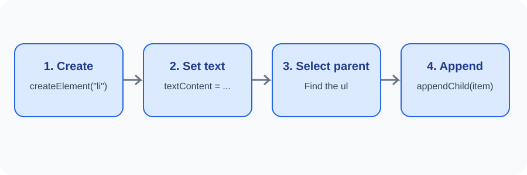

# Day 27 Lecture Notes — Changing Content and Creating Elements

## 1. Updating text
Select an existing element and update its text with textContent.

~~~js
const heading = document.querySelector("#heading");
heading.textContent = "A new heading";
~~~

## 2. Working with attributes
Attributes provide extra information on HTML elements. For example, an image has src and alt attributes.

~~~js
const photo = document.querySelector("#photo");
console.log(photo.getAttribute("alt"));
photo.setAttribute("alt", "A sample landscape");
~~~

Only use a real image path if you have an image file. Changing an attribute in the browser does not rewrite the original HTML file.

## 3. Change CSS classes
CSS classes help JavaScript change appearance without writing long style values.

~~~js
const notice = document.querySelector("#notice");
notice.classList.add("highlight");
notice.classList.remove("hidden");
notice.classList.toggle("highlight");
~~~

The matching CSS class must exist in the stylesheet if it should change the appearance.

## 4. Create a new element
Use document.createElement() to create an element that was not in the original HTML.

~~~js
const newItem = document.createElement("li");
newItem.textContent = "Practise JavaScript";
~~~

## 5. Add an element to the page
Select a parent element, then append the new item.

~~~js
const list = document.querySelector("#task-list");
list.appendChild(newItem);
~~~

The item now appears in the browser. It is not automatically saved in the HTML file.

## 6. Remove an element
An element can remove itself with remove().

~~~js
newItem.remove();
~~~

For a beginner demonstration, select an existing element and remove it after a button click. Explain that removed content is gone from the current page until it is added again or the page reloads.

## 7. A small complete example
~~~js
const list = document.querySelector("#task-list");
const addButton = document.querySelector("#add-button");

addButton.addEventListener("click", function () {
  const item = document.createElement("li");
  item.textContent = "A new practice task";
  list.appendChild(item);
});
~~~

## 8. Common mistakes
- Selecting the wrong parent element.
- Creating an element but forgetting to append it.
- Using a class name that is not defined in CSS.
- Confusing classList.add() with assigning text.
- Using innerHTML with user-entered text.
- Trying to remove an element that was never selected.

## 9. Review
1. Which method creates a new HTML element?
2. What does appendChild() do?
3. How can you add a CSS class?
4. What is the difference between textContent and setAttribute()?
5. Does a DOM change automatically save the HTML file?
