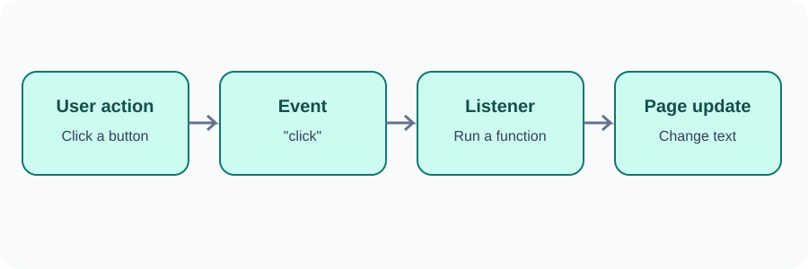

# Day 28 Instructor Guide — Events

## Preparation
Test both examples. Keep the counter code short. Prepare a live input field and preview paragraph.

## Outcomes
Students attach click and input listeners and explain when each callback runs.

## 120-minute plan
| Time | Activity |
|---|---|
| 0–20 min | Explain user actions and browser events |
| 20–24 min | Theory review |
| 24–54 min | Demonstrate click, named callback, counter, input event |
| 54–116 min | Practical exercises |
| 116–120 min | Review and student explanation |

## Demonstration
1. Ask a student to click a physical button; relate the action to a webpage event.
2. Attach a click listener and log a message.
3. Update a counter variable and its displayed text.
4. Add a reset listener.
5. Type into the name field and show the preview update.
6. Explain that the listener function runs after the event occurs.

## Visual aid
Use images/day-28-event-flow.svg: user action → event → listener function → page update.

## Questions
- Does addEventListener run the callback immediately?
- Why do we pass a function name without parentheses?
- When would you use click rather than input?
- Why do we use input.value to read a field?

## Common errors
- Function executes immediately: compare callback reference with callback invocation.
- Count changes in Console but not page: update the output text.
- No live preview: confirm event name and selector.
- Empty or unexpected field output: inspect the input ID and value.

## Support and extension
Support: provide selectors and starter variables. Core: counter with increase and reset. Extension: add a decrease button but prevent the counter from going below zero.

## Checkpoint
Students demonstrate one click listener and one input listener. Avoid introducing event delegation or complex event object properties.
