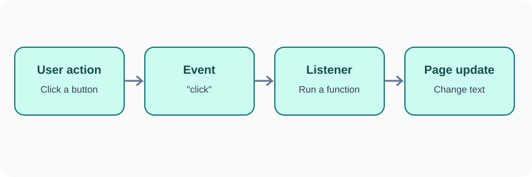

# Day 28 Lecture Notes — Events and Event Listeners

## 1. What is an event?
An event is an action or occurrence the browser can detect. Examples include a user clicking a button, typing in a field, or submitting a form.

## 2. Listen for a click
Select a button and attach a listener with addEventListener().

~~~js
const button = document.querySelector("#increase-button");

button.addEventListener("click", function () {
  console.log("The button was clicked.");
});
~~~

The first argument is the event name. The second is the function that runs when the event happens.

## 3. Use a named function
A function can be written separately and then used as the listener.

~~~js
function showMessage() {
  console.log("Hello from the button!");
}

button.addEventListener("click", showMessage);
~~~

Do not write showMessage() in addEventListener here. Pass the function name so the browser can call it when the click happens.

## 4. Update a counter
~~~js
let count = 0;
const output = document.querySelector("#count");
const increaseButton = document.querySelector("#increase-button");

increaseButton.addEventListener("click", function () {
  count = count + 1;
  output.textContent = count;
});
~~~

The variable remembers the count while the page remains open.

## 5. Reset a value
~~~js
const resetButton = document.querySelector("#reset-button");

resetButton.addEventListener("click", function () {
  count = 0;
  output.textContent = count;
});
~~~

## 6. Respond to typing
The input event happens when the value in a field changes as the user types.

~~~js
const nameInput = document.querySelector("#name-input");
const preview = document.querySelector("#name-preview");

nameInput.addEventListener("input", function () {
  preview.textContent = nameInput.value;
});
~~~

The value property contains the current field value. Use textContent to display it safely as plain text.

## 7. Event object — a small preview
The browser can pass an event object to the listener. Students only need to recognise it today.

~~~js
button.addEventListener("click", function (event) {
  console.log(event.type);
});
~~~

The output for this example is click. More event details are optional.

## 8. Common mistakes
- Calling the function instead of passing its name.
- Selecting an element before it exists because the script is missing defer.
- Forgetting to update the displayed number after changing the variable.
- Using textContent when the task needs to read an input value; use value.
- Typing an event name incorrectly.

## 9. Review
1. What is an event?
2. What does addEventListener() do?
3. Which event is suitable for a button click?
4. Which event can respond as a user types?
5. What does the value property return for an input?
