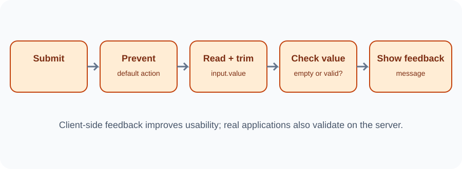

# Day 29 Instructor Guide — Forms and Validation

## Preparation
Test the sample form. Ensure it has a label connected to the input, a submit button, and a message paragraph. Use only fictional data.

## Outcomes
Students handle submit, prevent default navigation, read and trim a value, check for empty text, and show feedback.

## 120-minute plan
| Time | Activity |
|---|---|
| 0–20 min | Explain forms, labels, and user-friendly validation |
| 20–24 min | Theory review |
| 24–54 min | Demonstrate submit event, preventDefault, value, trim, conditions |
| 54–116 min | Practical exercises |
| 116–120 min | Review and safety reminder |

## Demonstration
1. Show a form with a label and text field.
2. Submit the form and observe the browser's default behaviour.
3. Add a submit listener.
4. Call preventDefault() and explain why.
5. Read the input value.
6. Test an empty field and a field containing spaces.
7. Use trim() and an if/else condition.
8. Display success or error feedback with textContent.
9. Explain that the example does not send or save data.

## Visual aid
Use images/day-29-form-validation-flow.svg to show: submit → prevent default → read and trim → check → feedback.

## Questions
- Why listen to the form rather than only the button?
- What does preventDefault change?
- Why is trim useful?
- Does browser validation secure a real server?

## Common errors
- Page refreshes: verify preventDefault is inside the submit callback.
- Input reads as undefined: confirm the correct selector and use value.
- Spaces accepted: use trim before checking.
- Label not connected: compare for and id values.

## Safety
Do not ask students to enter real personal details or passwords. Explain that the form is a local demonstration only. Client-side validation is not security.

## Differentiation
Support: provide the HTML and let students complete the if/else. Extension: add a maximum-length message or clear the input after successful feedback.

## Checkpoint
Students submit a blank form and a valid sample task and show different messages.
