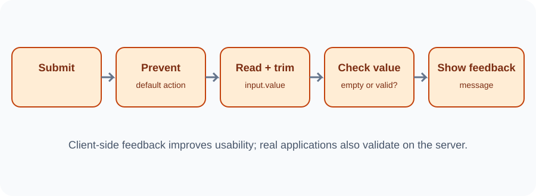

# Day 29 Lecture Notes — Forms and Basic Validation

## 1. Why forms are used
Forms let people enter information such as a search term, a message, or a task. A form can contain labels, input fields, buttons, and helpful instructions.

## 2. Connect a label and input
The label's for value should match the input's id.

~~~html
<label for="task-input">Task</label>
<input id="task-input" name="task" type="text" required>
~~~

This makes the field easier to understand and use with assistive technology.

## 3. Listen for form submission
A form can listen for the submit event.

~~~js
const form = document.querySelector("#task-form");

form.addEventListener("submit", function (event) {
  event.preventDefault();
  console.log("The form was submitted.");
});
~~~

preventDefault() stops the browser's default form navigation for this classroom example. It does not send data anywhere.

## 4. Read the value
~~~js
const taskInput = document.querySelector("#task-input");

form.addEventListener("submit", function (event) {
  event.preventDefault();
  const taskText = taskInput.value;
  console.log(taskText);
});
~~~

For an input element, use value to read what the user typed.

## 5. Remove extra spaces with trim()
A user might type only spaces. trim() removes spaces from the beginning and end of a string.

~~~js
const taskText = taskInput.value.trim();
~~~

Now a field containing only spaces becomes an empty string.

## 6. Check for an empty value
~~~js
if (taskText === "") {
  message.textContent = "Please enter a task.";
} else {
  message.textContent = "Your task is ready.";
}
~~~

Use a clear message so the user knows what to do next.

## 7. Use built-in HTML validation
HTML provides useful attributes such as required, minlength, maxlength, and type="email". These help the browser check simple input rules.

~~~html
<input type="text" required minlength="2" maxlength="60">
~~~

Do not tell students that browser validation makes a real application secure. A real server must validate data again.

## 8. Complete classroom example
~~~js
const form = document.querySelector("#task-form");
const taskInput = document.querySelector("#task-input");
const message = document.querySelector("#form-message");

form.addEventListener("submit", function (event) {
  event.preventDefault();
  const taskText = taskInput.value.trim();

  if (taskText === "") {
    message.textContent = "Please enter a task.";
    return;
  }

  message.textContent = "Task accepted: " + taskText;
  form.reset();
});
~~~

This example only displays a message. It does not save or send the task.

## 9. Common mistakes
- Listening for click on the submit button instead of the form submit event.
- Forgetting event.preventDefault() and seeing the page reload.
- Reading textContent instead of input.value.
- Forgetting trim(), so spaces pass the check.
- Using a label for value that does not match the input ID.
- Claiming client-side validation protects a database or server.

## 10. Review
1. What event is used when a form is submitted?
2. What does preventDefault() do in this example?
3. Which property reads the input value?
4. What does trim() remove?
5. Why does real server-side validation still matter?
