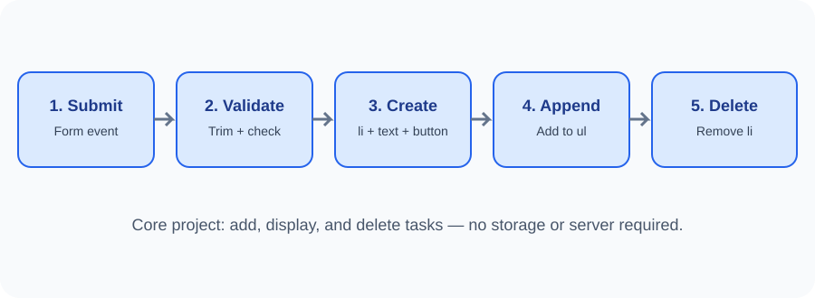

# Day 30 — Guided To-Do List Project

**Week:** 6 | **Session:** 30 | **Duration:** 120 minutes

## Project goal
Build a small To-Do List that lets a user add a task, see it in a list, and delete it. This project combines DOM selection, element creation, events, and basic form validation.

## Learning outcomes
Students can:
- Select a form, input, list, and feedback element.
- Handle form submission with preventDefault().
- Reject empty or whitespace-only tasks.
- Create an li and a delete button.
- Add the item to the page and remove it later.
- Explain that tasks are temporary and disappear after refresh.

## 120-minute project plan
| Time | Activity |
|---|---|
| 0–20 min | Review requirements and inspect starter files |
| 20–24 min | Quick theory review |
| 24–54 min | Instructor builds the first working version |
| 54–116 min | Students complete and customise the project |
| 116–120 min | Demonstration and review |

## Required features
1. A labelled task input.
2. An Add Task submit button.
3. Empty and whitespace-only values are rejected.
4. A valid task appears in the list.
5. Each task has a Delete button.
6. Feedback is shown to the user.
7. The page works after refresh by reloading the example, but tasks do not persist.

## Project files
- index.html — page structure.
- styles.css — appearance and responsive layout.
- script.js — DOM and event behaviour.

## Build stages
1. Read and understand the HTML structure.
2. Select form, input, list, and message in JavaScript.
3. Listen for submit and prevent default navigation.
4. Read and trim the task text.
5. If empty, show a message and stop.
6. Create an li, a span for task text, and a delete button.
7. Append the task to the list.
8. Add a click listener to the delete button.
9. Clear the input and show a success message.
10. Test empty input, spaces, long text, multiple tasks, and delete actions.

## Assessment — 10 marks
- Correct form and accessible label: 2
- Empty input handled correctly: 2
- New task is created and displayed: 2
- Delete button works: 2
- Clear code, styling, and explanation: 2

## Optional extensions
- Add a task counter.
- Add a Clear All button with a confirmation step.
- Mark a task as complete with a CSS class.
- Improve the visual design for mobile screens.

Do not require localStorage, separate data models, APIs, or frameworks for the core assessment.

## Important limitation
This app stores tasks only in the current page. Refreshing the page removes the tasks. It is a learning project, not a production task manager.

## Learning links
- [MDN — DOM Introduction](https://developer.mozilla.org/en-US/docs/Web/API/Document_Object_Model/Introduction)
- [MDN — addEventListener()](https://developer.mozilla.org/en-US/docs/Web/API/EventTarget/addEventListener)
- [MDN — Document.createElement()](https://developer.mozilla.org/en-US/docs/Web/API/Document/createElement)
