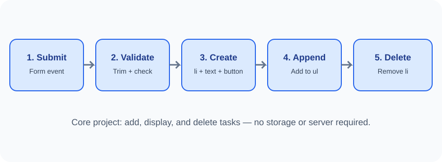

# Day 30 Lecture Notes — Build a To-Do List

## 1. What are we building?
A To-Do List is a small webpage where a user can enter a task, add it to a list, and delete it when finished. We will use only the HTML, CSS, and JavaScript already studied.

## 2. Project structure
~~~text
todo-list/
├── index.html
├── styles.css
└── script.js
~~~

The HTML creates the form and empty list. CSS makes the page clear. JavaScript handles user actions.

## 3. The HTML elements
~~~html
<form id="task-form">
  <label for="task-input">New task</label>
  <input id="task-input" type="text" maxlength="80">
  <button type="submit">Add task</button>
</form>

<ul id="task-list"></ul>
~~~

The label is connected to the input. The list starts empty because JavaScript will add items.

## 4. Select the elements
~~~js
const form = document.querySelector("#task-form");
const taskInput = document.querySelector("#task-input");
const taskList = document.querySelector("#task-list");
const message = document.querySelector("#message");
~~~

Store the selected elements in const variables because the element references do not need to be reassigned.

## 5. Handle the form submission
~~~js
form.addEventListener("submit", function (event) {
  event.preventDefault();
  // Add the task here.
});
~~~

preventDefault() stops the browser's normal form navigation while we handle the task in JavaScript.

## 6. Check the input
~~~js
const taskText = taskInput.value.trim();

if (taskText === "") {
  message.textContent = "Please enter a task.";
  return;
}
~~~

trim() removes spaces at the beginning and end. return stops the function when the task is empty.

## 7. Create the task elements
~~~js
const item = document.createElement("li");
const taskLabel = document.createElement("span");
const deleteButton = document.createElement("button");

taskLabel.textContent = taskText;
deleteButton.textContent = "Delete";
deleteButton.type = "button";
~~~

Use textContent for the task text. Do not insert user-entered text as HTML.

## 8. Add a delete action
~~~js
deleteButton.addEventListener("click", function () {
  item.remove();
});
~~~

The function removes the list item that contains this particular button.

## 9. Put everything together
~~~js
item.appendChild(taskLabel);
item.appendChild(deleteButton);
taskList.appendChild(item);
~~~

The item is first assembled, then added to the page.

## 10. Finish the form interaction
After adding the task:
- Clear the input with form.reset() or taskInput.value = "".
- Show a success message.
- Keep the user's attention on the input if time permits.

## 11. Test carefully
- Submit an empty field.
- Submit spaces only.
- Add one task.
- Add several tasks.
- Delete the first, middle, and last task.
- Try a long task.
- Refresh and observe that tasks disappear.

## 12. Common mistakes
- Forgetting preventDefault(), which causes the page to reload.
- Forgetting trim(), so spaces are accepted.
- Creating an li but not appending it.
- Creating a delete button but not attaching its click listener.
- Using the same global variable for every new item.
- Using innerHTML with user input.
- Expecting tasks to remain after refresh.

## 13. Review questions
1. Which event handles the form submission?
2. Why do we call trim()?
3. Which method creates an li?
4. How does each delete button know which item to remove?
5. Why do tasks disappear after refresh?
