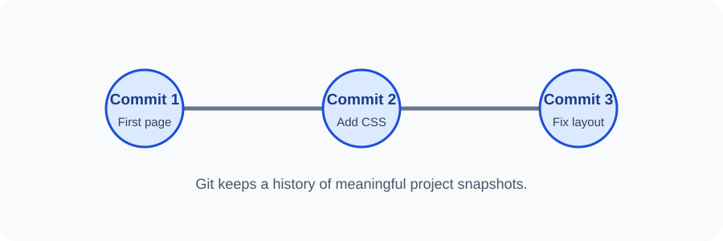

# Day 31 Instructor Guide — Git Foundations

## Preparation
Check Git is installed on the instructor computer. Prepare a small website folder with index.html and styles.css. Show the official Git download page.

## Outcomes
Students describe Git and GitHub accurately, understand repository and commit, and check Git installation.

## 120-minute plan
| Time | Activity |
|---|---|
| 0–20 min | Explain version control and Git vs GitHub |
| 20–24 min | Review questions |
| 24–54 min | Demonstrate Git download page, terminal and git --version |
| 54–116 min | Students check setup and organise a practice project |
| 116–120 min | Exit review |

## Demonstration
1. Show a project before and after a small edit.
2. Explain why a folder named final-final-latest can become confusing.
3. Introduce Git as a history of project snapshots.
4. Contrast local Git with online GitHub.
5. Open the VS Code terminal and run git --version.
6. Demonstrate Git identity configuration using placeholder values only.
7. Explain that no files are uploaded today.

## Visual aid
Use images/day-31-version-history.svg. Explain that each commit records a meaningful project state.

## Questions
- Can Git work without GitHub?
- Is GitHub itself the Git command?
- What information does a commit record?
- Why should secrets never be committed?

## Common errors
- Git command unavailable: check installation and reopen terminal.
- Students confuse repo with website: clarify repository is a tracked project.
- Students use a shared email or identity: ask each student to use their own appropriate details.

## Support and extension
Support: pair students to check Git installation and explain key words. Extension: students write a short paragraph explaining one reason a developer uses version control.

## Checkpoint
Every student can say in their own words: "Git tracks changes; GitHub hosts Git repositories online."
