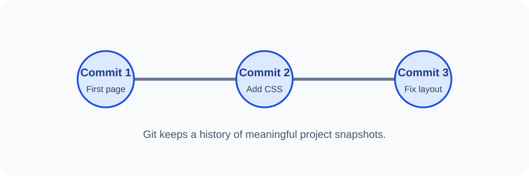

# Day 31 Lecture Notes — Git and Version Control

## 1. Why version control?
When a project changes, it is useful to know what changed and when. Version control keeps a history of changes so a developer can review earlier work and understand project progress.

## 2. What is Git?
Git is a version-control system. It runs on your computer and records snapshots of project changes in a repository.

## 3. What is GitHub?
GitHub is an online service where developers can store Git repositories, share code, and work together. Git and GitHub are related, but they are not the same thing.

| Git | GitHub |
|---|---|
| A version-control tool | An online hosting and collaboration service |
| Works on your computer | Works through the internet |
| Records project history | Hosts repositories and supports collaboration |

## 4. Important words
- **Repository (repo):** a project tracked by Git.
- **Commit:** a saved snapshot in the project's history.
- **Working folder:** files you are currently editing.
- **History:** a record of previous commits.
- **Terminal:** a text-based place to enter commands.

## 5. Install Git
1. Visit [git-scm.com/downloads](https://git-scm.com/downloads).
2. Choose the correct installer for your operating system.
3. Follow the installer instructions. Use the normal recommended settings unless your instructor gives different instructions.
4. Close and reopen VS Code or the terminal after installation if Git is not detected.

## 6. Check the installation
Open the VS Code terminal and type:

~~~bash
git --version
~~~

A version number means the command is available. If the terminal says the command is not recognised, ask the instructor to check the installation and PATH settings.

## 7. Set your author name and email
Git uses a name and email to label commits. Use your own appropriate account details. Do not use another student's identity.

~~~bash
git config --global user.name "Your Name"
git config --global user.email "you@example.com"
~~~

These are examples. Replace them with your own name and email. Do not publish private information in a public project.

## 8. A simple project folder
~~~text
practice-website/
├── index.html
└── styles.css
~~~

Git can track changes to both files. The project remains on your computer until you connect it to an online service.

## 9. Safety
Never commit passwords, access tokens, private keys, private student records, or confidential files. A public repository can be viewed by other people.

## 10. Review
1. What problem does version control help solve?
2. What is Git?
3. What is GitHub?
4. What is a commit?
5. Which command checks the installed Git version?
