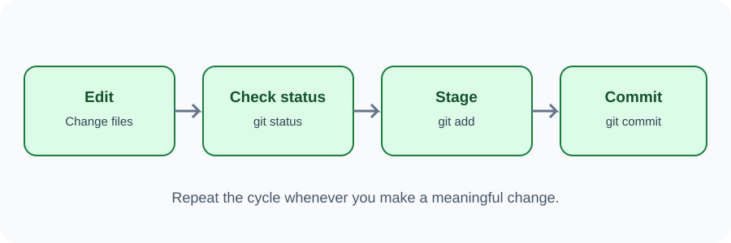

# Day 32 Instructor Guide — Local Git Workflow

## Preparation
Prepare a small HTML/CSS project. Ensure Git is installed and author identity is configured. Have a clean folder for demonstration.

## Outcomes
Students run init, status, add, commit, and log in the correct project folder.

## 120-minute plan
| Time | Activity |
|---|---|
| 0–20 min | Explain working tree, staging, and commits |
| 20–24 min | Theory review |
| 24–54 min | Demonstrate the five core commands |
| 54–116 min | Students create two commits |
| 116–120 min | Review command sequence |

## Demonstration
1. Open the project folder in VS Code.
2. Open terminal and check the current directory.
3. Run git init.
4. Run git status and interpret untracked files.
5. Stage index.html with git add.
6. Run status again.
7. Commit with a clear message.
8. Change a heading, stage and commit again.
9. Run git log --oneline.
10. Explain that commits are local until pushed.

## Visual aid
Use images/day-32-git-workflow.svg. Repeat the cycle: edit → status → stage → commit.

## Questions
- Why check status before committing?
- Can you commit an unstaged file?
- Why should messages describe the change?
- Does commit mean upload?

## Common errors
- Git says identity unknown: configure user.name and user.email.
- Nothing to commit: check whether the file changed and was saved.
- Wrong folder: inspect terminal location and open correct folder.
- Commit did not include a file: run status and stage the intended file.

## Differentiation
Support: provide command cards in order. Extension: make three commits with meaningful messages and explain each.

## Checkpoint
Every student shows a repository with at least two commits.
