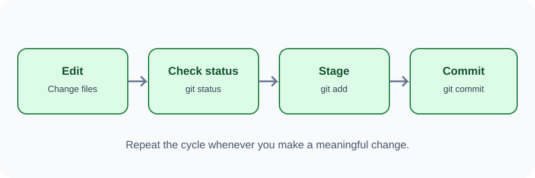

# Day 32 Lecture Notes — Git Commands and Commits

## 1. Create a local repository
Open the terminal inside your project folder and run:

~~~bash
git init
~~~

This creates a Git repository in the current folder. Run it in the correct project folder, not in a folder containing unrelated personal files.

## 2. Check the repository status
~~~bash
git status
~~~

This tells you which files are untracked, modified, or staged.

## 3. Stage files
Staging means choosing which changes will go into the next commit.

~~~bash
git add index.html
~~~

To stage all changes in the current project folder:

~~~bash
git add .
~~~

Use git status after staging so you can see what will be committed.

## 4. Create a commit
~~~bash
git commit -m "Create first webpage"
~~~

A commit records the staged changes with a short message. Use a message that explains what changed.

Good examples:
- Create homepage structure
- Add responsive navigation styles
- Fix contact section spacing

Avoid messages such as update, stuff, or final.

## 5. View project history
~~~bash
git log --oneline
~~~

This shows a short list of commits.

## 6. The normal beginner workflow
1. Edit files.
2. Run git status.
3. Stage the changes with git add.
4. Run git status again.
5. Commit with a clear message.
6. View history when needed.

## 7. Important words
- **Untracked:** Git has not started tracking this file.
- **Modified:** a tracked file has changed since the last commit.
- **Staged:** a change is selected for the next commit.
- **Commit:** a saved point in the repository history.

## 8. Common mistakes
- Running git init in the wrong folder.
- Forgetting git add before committing.
- Committing without checking status.
- Writing unclear commit messages.
- Thinking a commit automatically uploads files to GitHub. A local commit stays on your computer until it is pushed to a remote repository.

## 9. Review
1. What does git init do?
2. Which command shows file status?
3. What does git add do?
4. What does git commit do?
5. Does a local commit automatically upload to GitHub?
