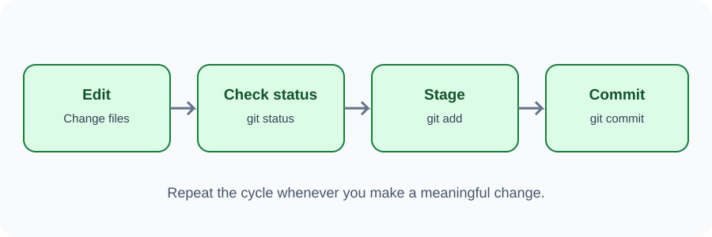

# Day 32 Practical Exercises — Your First Commits

## Exercise 1 — Open the correct folder
Open your practice website folder in VS Code. Confirm the terminal is inside that folder.

## Exercise 2 — Initialise Git
~~~bash
git init
git status
~~~

Observe the untracked files.

## Exercise 3 — Stage the HTML file
~~~bash
git add index.html
git status
~~~

Find the staged file in the status output.

## Exercise 4 — First commit
~~~bash
git commit -m "Create first webpage"
~~~

## Exercise 5 — Make a second change
Edit the page title or heading. Save the file, then run:

~~~bash
git status
git add index.html
git commit -m "Update page heading"
git log --oneline
~~~

## Required independent task
Add or update styles.css and create a third commit with a meaningful message.

## Checklist
- [ ] I initialised Git in the correct folder.
- [ ] I checked status.
- [ ] I staged the correct file.
- [ ] I made two or more commits.
- [ ] I can view commit history.

## Optional challenge
Use git add . and explain why checking status before committing is important.

## Troubleshooting
If Git asks for identity, configure your own name and email. If there is nothing to commit, save a real file change and check status again.
