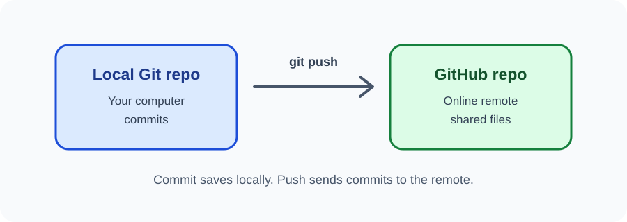

# Day 33 Instructor Guide — GitHub Remote Workflow

## Preparation
Check access to GitHub and prepare a demonstration repository. Ensure the local project has at least one commit. Explain account age and eligibility requirements before signup.

## Outcomes
Students create or access an account, create a repository, connect origin, push main, and verify files.

## 120-minute plan
| Time | Activity |
|---|---|
| 0–20 min | Explain local vs remote repository and account safety |
| 20–24 min | Review Git command sequence |
| 24–54 min | Demonstrate repository creation and first push |
| 54–116 min | Students publish their practice project |
| 116–120 min | Verify repository contents |

## Demonstration
1. Sign in to a demonstration GitHub account.
2. Create an empty repository.
3. Copy its HTTPS URL.
4. In the local project, inspect git status and git remote -v.
5. Add origin only if it does not already exist.
6. Rename current branch to main.
7. Push with upstream tracking.
8. Complete authentication through the supported browser or credential manager flow.
9. Refresh GitHub and inspect the files.
10. Make a tiny edit, commit, and push again.

## Visual aid
Use images/day-33-local-remote.svg. Explain push as sending local commits to the online remote.

## Questions
- Is GitHub the same thing as Git?
- What does origin usually mean?
- What is the difference between commit and push?
- Why should the repository be empty before the first push in this class workflow?

## Common errors
- Remote already exists: inspect git remote -v; do not add a second origin.
- Authentication rejected: use browser/device sign-in or Git Credential Manager; never enter an account password in a command.
- Repository not found: verify URL, account, and access.
- Push rejected due to unrelated history: stop and ask the instructor; do not introduce force push as a quick fix.

## Safety and inclusion
Never ask students to reveal passwords or verification codes. Provide a demonstration alternative for students who cannot create an account or whose accounts are restricted.

## Checkpoint
Student opens their own repository page and points to the uploaded HTML and CSS files.
